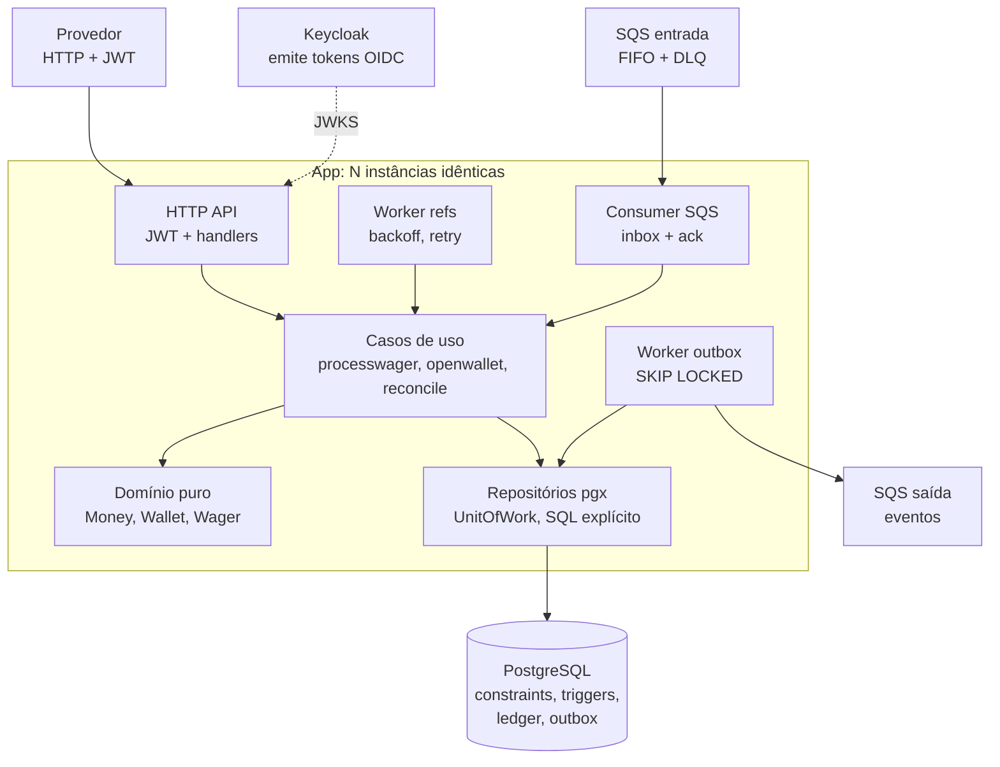
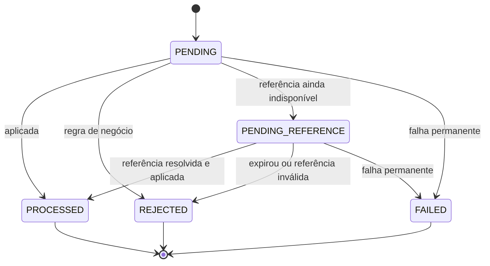

# ARCHITECTURE

Decisões técnicas do serviço de processamento distribuído de apostas.

> **Status:** documento de projeto escrito antes da implementação da aplicação (o CI/CD da seção 18 já está em funcionamento). Tudo o mais aqui descreve o que será construído, na ordem de [docs/ROADMAP.md](docs/ROADMAP.md). As três decisões mais difíceis de reverter têm registro próprio em [docs/adr](docs/adr): [aceite síncrono](docs/adr/0001-synchronous-acceptance.md), [lock pessimista por carteira](docs/adr/0002-per-wallet-pessimistic-lock.md) e [dinheiro em `int64`](docs/adr/0003-money-as-int64-minor-units.md); os termos estão em [CONTEXT.md](CONTEXT.md). Conforme o código for entregue, a seção [Limitações e trabalho não concluído](#17-limitações-interpretações-e-trabalho-não-concluído) deve ser atualizada com o que mudou ou ficou de fora.

## Sumário

1. [Visão geral](#1-visão-geral)
2. [Stack e justificativas](#2-stack-e-justificativas)
3. [Estrutura de pacotes](#3-estrutura-de-pacotes)
4. [Dinheiro (`Money`)](#4-dinheiro-money)
5. [Modelo de dados e invariantes no banco](#5-modelo-de-dados-e-invariantes-no-banco)
6. [Transações SQL e acesso ao banco](#6-transações-sql-e-acesso-ao-banco)
7. [Concorrência](#7-concorrência)
8. [Idempotência](#8-idempotência)
9. [Máquina de estados e fluxos](#9-máquina-de-estados-e-fluxos)
10. [Referências pendentes e reversões](#10-referências-pendentes-e-reversões)
11. [Contrato HTTP: códigos e `failureCode`](#11-contrato-http-códigos-e-failurecode)
12. [Inbox, SQS e outbox](#12-inbox-sqs-e-outbox)
13. [Autenticação e autorização](#13-autenticação-e-autorização)
14. [Uber Fx, ciclo de vida e shutdown](#14-uber-fx-ciclo-de-vida-e-shutdown)
15. [Observabilidade](#15-observabilidade)
16. [Estratégia de testes](#16-estratégia-de-testes)
17. [Limitações, interpretações e trabalho não concluído](#17-limitações-interpretações-e-trabalho-não-concluído)
18. [CI/CD](#18-cicd)

---

## 1. Visão geral

Arquitetura hexagonal (ports and adapters) em um único módulo Go. Toda instância da aplicação é idêntica: o mesmo binário sobe a API HTTP, um consumidor SQS e os workers. Isso **não** significa que cada instância tenha suas próprias filas ou seu próprio processamento. Os recursos são compartilhados entre todas as instâncias:

- **Uma única fila de entrada** (`wager-transactions.fifo`). As instâncias são consumidores concorrentes dela: o SQS entrega cada mensagem a uma instância por vez (as demais não a enxergam durante o visibility timeout) e, se essa instância falhar antes de apagá-la, qualquer outra pode recebê-la de novo.
- **Um único PostgreSQL**, que guarda o estado financeiro, a idempotência, a inbox e a outbox.
- **Workers que disputam as mesmas linhas.** O worker de outbox e o de referências rodam em todas as instâncias sobre as mesmas tabelas; `FOR UPDATE SKIP LOCKED` faz cada instância reservar linhas diferentes.

Por isso qualquer instância pode processar qualquer operação, e não há coordenação em memória entre elas: todo estado compartilhado vive no PostgreSQL. Uma instância que cai deixa trabalho que outra assume (mensagem não apagada volta à fila; lease de worker expira).



Princípios que guiam as decisões:

- **O banco é a fonte da verdade das invariantes.** Locks em memória e a deduplicação do SQS FIFO são otimizações, nunca a garantia.
- **Aceite síncrono.** A requisição só responde depois do commit do resultado. Não existe um commit intermediário de aceite (ver [seção 9](#9-máquina-de-estados-e-fluxos)).
- **HTTP e SQS compartilham o mesmo caso de uso** (`processwager`), portanto as mesmas garantias.
- **Falha transitória desfaz tudo; rejeição de negócio é registrada.** Uma rejeição confirmada é terminal e auditável.

## 2. Stack e justificativas

| Responsabilidade | Escolha | Papel / justificativa |
| --- | --- | --- |
| Linguagem | Go 1.27.2 | A mesma versão fica declarada em `go.mod` e na imagem de build do Dockerfile. |
| Composição | Uber Fx | Injeção por construtores e ciclo de vida (`fx.Lifecycle`). Ver [seção 14](#14-uber-fx-ciclo-de-vida-e-shutdown). |
| HTTP | `net/http` (`ServeMux` com método e path params) | Suficiente para os endpoints; evita dependência extra. |
| Banco | PostgreSQL 16 | Constraints, triggers, `FOR UPDATE`, `SKIP LOCKED`, `REPEATABLE READ`. |
| Acesso ao banco | `pgx/v5` + `pgxpool`, SQL explícito | Controle total de transação, locks e `ON CONFLICT`. Sem ORM. |
| Migrations | `golang-migrate` (`.up.sql` / `.down.sql`) | Padrão do ecossistema, CLI simples para aplicar e reverter. |
| Mensageria | AWS SQS FIFO via `aws-sdk-go-v2`, LocalStack localmente | Long polling e controle de visibility timeout. |
| IdP | Keycloak | OIDC/OAuth 2.0, `client_credentials` entre serviços, realm importável. |
| Validação de token | `go-jose` v4 (JWS e `jwt`), com cache próprio das chaves | Valida assinatura, algoritmo, `iss`, `aud`, `exp` e `nbf` localmente. Não usamos o `go-oidc` porque seu `RemoteKeySet` busca as chaves de novo a cada `kid` desconhecido, sem limite (o que deixaria qualquer um forçar uma requisição ao Keycloak por token), e embrulha os erros de assinatura como texto, o que impede classificar a falha por motivo. |
| IDs | UUIDv7 (`google/uuid`) | Ordenável no tempo; ajuda na paginação por cursor. |
| Logs | `log/slog` (JSON) | Biblioteca padrão. |
| Métricas | `prometheus/client_golang` | Contadores, histogramas e gauges em `/metrics`. |
| Configuração | Variáveis de ambiente (`caarlos0/env`) | Validada no boot; `.env.example` versionado. |
| Testes | `testing`, `testify`, `testcontainers-go` | Infraestrutura real (Postgres, Keycloak, LocalStack). |
| Documentação da API | OpenAPI 3.0.3 escrito à mão, Swagger UI, `kin-openapi` | Contrato definido antes dos handlers e validado por teste. Ver [seção 11](#11-contrato-http-códigos-e-failurecode). |

## 3. Estrutura de pacotes

```
api/openapi.yaml           contrato HTTP (OpenAPI 3.0.3), embutido no binário
cmd/api/main.go            só fx.New(...).Run()
internal/
  domain/                  puro: sem Fx, HTTP, SQS nem pgx
    money/                 value object Money
    wallet/                agregado Wallet + WalletLedgerEntry
    wager/                 WagerTransaction, estados, regras por tipo, failure codes
    event/                 eventos de domínio e envelope
  application/             casos de uso e portas (interfaces)
    openwallet/ processwager/ resolvepending/ reconcile/
  adapters/
    httpapi/ postgres/ sqsclient/ sqsconsumer/ sqspublisher/ outbox/ pendingref/ auth/
  platform/                config, logger, métricas, health
  app/                     composição de todos os fx.Module
migrations/                NNNNNN_nome.up.sql / .down.sql
deploy/                    init do Postgres (papéis), realm do Keycloak, init do LocalStack
test/                      integração e2e (build tag `integration`)
docker-compose.yml         Postgres, migrate, LocalStack, Keycloak e 3 instâncias da app
docs/CHALLENGE.md          enunciado original do desafio
README.md                  instruções de execução da solução
```

Regra de dependência: `adapters → application → domain`, nunca o contrário. Os repositórios devolvem entidades pelas funções `Rehydrate`, que **não** reaplicam movimentações, transições nem emitem eventos.

## 4. Dinheiro (`Money`)

**Representação:** `int64` em unidades mínimas (centavos) mais um código de moeda ISO 4217. Persistido como `BIGINT` (valor) e `CHAR(3)` (moeda).

- **Escala fixa de 2 casas.** Limitação assumida: moedas com outra escala (JPY, KWD) não são suportadas. O desafio fixa duas casas.
- **Limites:** o intervalo de um `int64`, de `-9.223.372.036.854.775.808` a `9.223.372.036.854.775.807` centavos, ou seja, de `-92.233.720.368.547.758,08` a `92.233.720.368.547.758,07` unidades. Entrada externa nunca é negativa, então vai de `0,00` a `92.233.720.368.547.758,07`.
- **Overflow:** `Add`, `Sub`, `Neg` e o parsing verificam estouro antes de operar (por exemplo, `a > MaxInt64 - b`) e retornam `ErrOverflow`. `Neg` de `MinInt64` também é tratado.
- **Sem ponto flutuante** em nenhuma etapa: o parsing opera sobre a string e converte direto para inteiro; a serialização formata inteiros.
- **Moedas incompatíveis:** `Add`, `Sub` e comparações retornam `ErrCurrencyMismatch`.
- **Valor zero** é criado por `Zero(currency)`. O zero value de `Money` (sem moeda) é inválido e rejeitado.
- **Moedas aceitas:** o código ISO 4217 é validado contra uma lista fechada no domínio (inicialmente `BRL`, `USD` e `EUR`, todas com duas casas). Códigos fora da lista são rejeitados. Os cenários principais usam `BRL`; as outras existem para os testes de incompatibilidade.

**Formato de entrada (estrito):** o valor precisa casar com `^(0|[1-9][0-9]*)\.[0-9]{2}$`.

| Entrada | Resultado |
| --- | --- |
| `"25.00"` | aceita |
| `"25"`, `"25.0"`, `"25.000"` | rejeitada (escala diferente de 2) |
| `""`, `"NaN"`, `"Infinity"`, `"1e2"` | rejeitada |
| `"-5.00"`, `"+5.00"` | rejeitada nas entradas financeiras externas |
| `"007.00"`, `".50"` | rejeitada |

Como não aceitamos formas equivalentes, **não há normalização** antes do hash de idempotência: a string canônica é a própria entrada. Nenhuma entrada inválida é arredondada.

Valores negativos existem apenas em cálculos internos; o saldo da carteira é protegido por `CHECK (balance_minor >= 0)`.

**API do pacote `internal/domain/money`** (só biblioteca padrão; a decisão está em [ADR 0003](docs/adr/0003-money-as-int64-minor-units.md)):

- `Parse(amount, currency)` lê entrada externa com o formato estrito e devolve `ErrInvalidFormat`, `ErrNegative` (inclusive `-0.00`), `ErrOverflow` ou `ErrUnknownCurrency`; `FromMinor` e `Zero` constroem a partir de centavos, e só `FromMinor` aceita negativos (diferenças internas).
- `Add`, `Sub`, `Neg` e `Compare` exigem moedas iguais (`ErrCurrencyMismatch`) e valores inicializados (`ErrUninitialized`); `Add`, `Sub` e `Neg` detectam overflow, inclusive negar o menor valor.
- O JSON é sempre `{"amount":"25.00","currency":"BRL"}`: o valor é string (nunca número JSON), os dois campos são obrigatórios, campos desconhecidos e dados depois do objeto são recusados, todo erro de decodificação é classificável por `errors.Is` sem expor tipos internos do decodificador, e uma decodificação que falha deixa o receptor como valor zero inválido. A escrita não é o espelho da leitura de propósito: um valor negativo pode ser escrito (a `difference` da reconciliação pode ser negativa), mas nunca é aceito na leitura, como em qualquer entrada externa. O ida e volta exato vale para todo valor válido como entrada externa.
- Como só existe uma forma textual válida por valor, `Parse(x).String() == x` para tudo que `Parse` aceita; isso é verificado por fuzz.
- Testes garantem que o pacote não usa `float` (nem em literais, `ParseFloat`, `big.Float` ou `math.Float64bits`) e que não importa nada fora da biblioteca padrão nem, dentro dela, rede, sistema operacional, banco de dados ou C.

## 5. Modelo de dados e invariantes no banco

Resumo das tabelas e das garantias impostas pelo schema (as colunas completas ficam nas migrations).

### `wallets`

| Coluna | Observação |
| --- | --- |
| `id UUID PK`, `player_id UUID`, `currency CHAR(3)` | |
| `balance_minor BIGINT NOT NULL` | `CHECK (balance_minor >= 0)` |
| `version BIGINT NOT NULL` | `CHECK (version >= 1)`; começa em 1, só sobe quando o saldo muda |
| `last_transaction_id UUID NULL` | transação que produziu o saldo atual; `NULL` em carteira aberta com zero e sem movimentação |
| `created_at`, `updated_at TIMESTAMPTZ` | |

`UNIQUE (player_id, currency)` garante uma única carteira por jogador e moeda (conflito ao abrir outra).

**Agregado (`internal/domain/wallet`):** `Wallet` é um valor imutável. `Open` cria a carteira vazia e `OpenWithBalance` a cria já financiada pela transação `OPENING` (versão 1, com o lançamento de crédito de 0 até o saldo inicial); `Rehydrate` restaura o estado guardado sem aplicar movimento nem emitir evento, recusando só o que o banco nunca guardaria. `Debit` e `Credit` recebem um `Movement` (id do lançamento, id da Wager Transaction, valor, instante) e devolvem a carteira seguinte e o `LedgerEntry`; um movimento recusado não devolve nada utilizável. O valor precisa ser positivo e na moeda da carteira, um débito além do saldo é `ErrInsufficientFunds`, e a versão sobe em exatamente um a cada movimento aceito. `LedgerEntry` valida a aritmética (`balanceAfter = balanceBefore ± valor` conforme a direção, sem overflow) na construção, e é o mesmo construtor que restaura um lançamento guardado. Um teste de AST garante que o pacote só depende da biblioteca padrão, de `uuid` e de `money`.

#### Coerência entre saldo e ledger imposta pelo banco

O `CHECK (balance_minor >= 0)` é a **última barreira**, não a proteção principal. Ele não detecta um lost update (duas transações que leem 100 e gravam 20 deixam um valor válido) nem um lançamento duplicado com saldo suficiente. Quem evita essas situações são o lock por carteira (seção 7) e as constraints de unicidade (abaixo). Para que o banco também recuse um saldo alterado sem o lançamento correspondente, há dois triggers na tabela `wallets`:

1. **`wallets_version_guard`** (`BEFORE INSERT OR UPDATE`, por linha): no `INSERT`, exige `version = 1`. No `UPDATE`, se `balance_minor` mudou, exige `NEW.version = OLD.version + 1` e `NEW.last_transaction_id` diferente do anterior; se não mudou, exige `NEW.version = OLD.version`. Impede pular, repetir ou alterar versão sem movimentação.
2. **`wallets_ledger_guard`** (`CONSTRAINT TRIGGER AFTER INSERT OR UPDATE OF balance_minor`, `DEFERRABLE INITIALLY DEFERRED`): verificado no commit. Exige um lançamento em `wallet_ledger_entries` com `(wallet_id, transaction_id) = (NEW.id, NEW.last_transaction_id)`, cujo `balance_before_minor` seja o saldo anterior (`OLD.balance_minor`, ou `0` na abertura) e cujo `balance_after_minor` seja `NEW.balance_minor`. A busca usa o índice único `(wallet_id, transaction_id)`. Uma abertura com saldo zero não exige lançamento.

E um trigger na tabela de lançamentos:

3. **`ledger_wallet_guard`** (`CONSTRAINT TRIGGER AFTER INSERT`, diferido): exige que a carteira, no commit, tenha `last_transaction_id = NEW.transaction_id` e `balance_minor = NEW.balance_after_minor`. Impede lançamento sem a mudança de saldo correspondente.

Com isso, o encadeamento do ledger (o `balance_before` de cada lançamento é o `balance_after` do anterior) passa a ser garantido pelo banco, e não só pelo código. Um bug que altere o saldo sem lançamento, com valores errados ou com lançamento órfão faz a transação inteira ser abortada no commit.

**Regra decorrente: uma operação financeira por transação SQL.** Os triggers diferidos comparam o estado da carteira no commit com cada lançamento, então duas movimentações da mesma carteira numa única transação seriam recusadas. Workers que processam lotes (referências pendentes) executam cada item em uma transação própria.

### `wager_transactions`

Cobre operações externas e `OPENING` na mesma tabela, distinguidas por `origin`.

- `origin` (`EXTERNAL` | `INTERNAL`) e `kind` (`OPENING`, `BET`, `WIN`, `LOSS`, `REFUND`, `ROLLBACK`).
- Identificação: `id`, `provider_id`, `external_transaction_id`, `idempotency_key`, `payload_hash`.
- Contexto: `requested_wallet_id` (o id recebido, sem chave estrangeira), `wallet_id` (chave estrangeira para `wallets`; `NULL` apenas quando a carteira não existe), `player_id`, `round_id`, `game_id`, `amount_minor`, `currency`.
- Referência: `reference_external_transaction_id` (informada) e `reference_transaction_id` (resolvida).
- Estado: `status`, `failure_code`, `result_balance_minor` (saldo observado no processamento, usado no replay), `result_wallet_version`.
- Retomada: `attempts`, `next_attempt_at`, `locked_until`, `expires_at`.
- Rastreamento: `correlation_id`.
- Timestamps: `created_at`, `updated_at`, `processed_at`.

Constraints:

- `CHECK` que amarra `origin` aos campos: em `INTERNAL`, `kind = 'OPENING'` e provedor, id externo, chave, hash, rodada, jogo e referência são `NULL`; em `EXTERNAL`, `kind <> 'OPENING'` e os campos externos são `NOT NULL`. Isso impede que `OPENING` entre pelo caminho externo mesmo se a aplicação falhar.
- `UNIQUE (provider_id, idempotency_key)` onde `origin = 'EXTERNAL'`. A chave é escopada por provedor: a chave de um provedor nunca colide com a de outro, e uma colisão não revela a existência de transações alheias.
- `CHECK (wallet_id IS NOT NULL OR (status = 'REJECTED' AND failure_code = 'WALLET_NOT_FOUND'))`: só a rejeição por carteira inexistente fica sem carteira. Assim a rejeição pode ser persistida (e reproduzida no replay) sem relaxar a chave estrangeira de quem movimenta dinheiro.
- `UNIQUE (provider_id, external_transaction_id)`: uma operação financeira não é reaplicada com outra chave.
- `UNIQUE (wallet_id) WHERE kind = 'OPENING'`: impede crédito inicial duplicado.
- `CHECK` do valor por tipo (`LOSS` exige zero; `BET`, `WIN`, `REFUND`, `ROLLBACK` exigem maior que zero).
- Índice único parcial `UNIQUE (reference_transaction_id) WHERE kind IN ('REFUND','ROLLBACK') AND status = 'PROCESSED'`: **uma referência recebe no máximo uma reversão bem-sucedida**, seja `REFUND` ou `ROLLBACK` (ver [seção 10](#10-referências-pendentes-e-reversões)).
- Trigger que bloqueia transição a partir de estado terminal (`PROCESSED`, `REJECTED`, `FAILED`) e qualquer alteração dos campos de identidade e financeiros (provedor, ids, chave, hash, carteira, tipo, valor, moeda) em qualquer estado. É a segunda barreira além da máquina de estados do domínio.

### `wallet_ledger_entries`

- `id`, `wallet_id`, `transaction_id`, `direction` (`DEBIT` | `CREDIT`), `amount_minor`, `balance_before_minor`, `balance_after_minor`, `created_at`.
- `UNIQUE (wallet_id, transaction_id)`.
- `CHECK (amount_minor > 0)` e `CHECK` da aritmética: `balance_after = balance_before + amount` para `CREDIT` e `balance_before - amount` para `DEBIT`.
- **Append-only:** trigger `BEFORE UPDATE OR DELETE` (e `BEFORE TRUNCATE`) que levanta exceção. Além disso, o usuário de banco da aplicação não recebe `UPDATE`, `DELETE` nem `TRUNCATE` nesta tabela.
- Correções financeiras são novos lançamentos (reversões), nunca edição.

### `inbox`

`(consumer_name, message_id)` como chave primária, `payload_hash` (SHA-256 em hexadecimal minúsculo, verificado por `CHECK`), `received_at` e `completed_at` (nulo só dentro da transação que trata a mensagem: como a linha e o que a mensagem causou confirmam juntos, uma linha visível para outra transação significa "tratada"). O papel da aplicação só insere e completa: `REVOKE UPDATE, DELETE, TRUNCATE` e `GRANT UPDATE (completed_at)`, de modo que ela não reescreve o que uma mensagem era nem esquece uma mensagem (esquecer deixaria uma mensagem ser tratada duas vezes). A inbox não tem expiração: o crescimento é de uma linha por mensagem e a política de retenção fica como trabalho futuro.

### `outbox`

`event_id UUID PK`, `aggregate_id` (a carteira), `event_type`, `version`, `payload JSONB` (snapshot imutável, sempre um objeto), `correlation_id`, `causation_id`, `occurred_at`, `published_at`, mais o estado de publicação: `seq` (identidade gerada, a ordem de escrita), `attempts`, `next_attempt_at`, `locked_until` e `last_error`. Índices parciais nos não publicados: por `occurred_at` (a defasagem), por `seq` (o que está pendente) e por `(aggregate_id, seq)` (o que vem antes na mesma carteira). O trigger `outbox_guard` recusa qualquer mudança no conteúdo do evento e qualquer mudança em um evento já publicado.

### Estado atual do schema (migrations 000002 a 000008)

| Migration | Conteúdo |
| --- | --- |
| `000002_wallets` | `wallets` e o trigger `wallets_version_guard`. Além das regras acima, ele impede que `id`, `player_id` e `currency` mudem. |
| `000003_wager_transactions` | `wager_transactions` só com a identidade e o resultado; as colunas de tentativa e lease (`attempts`, `next_attempt_at`, `locked_until`, `expires_at`) e o índice de reversão chegam com os tickets que os usam. Constraints: `origin_fields_check` (abertura interna x pedido externo), `wallet_check`, `amount_check` e `failure_code_check` (só `REJECTED` e `FAILED` têm código de falha). Estados terminais são imutáveis por inteiro; `PENDING_REFERENCE` só avança. |
| `000004_wallet_ledger` | `wallet_ledger_entries`, append-only para todos (trigger para o dono, `REVOKE UPDATE, DELETE, TRUNCATE` para `wagering_app`) e os dois triggers de coerência diferidos. |
| `000005_outbox` | `outbox` com `payload` obrigatoriamente objeto JSON e o índice parcial dos eventos não publicados (`occurred_at WHERE published_at IS NULL`). |
| `000006_outbox_publishing` | O estado de publicação (`seq`, `attempts`, `next_attempt_at`, `locked_until`, `last_error`), os índices parciais do publicador e o trigger `outbox_guard` (conteúdo imutável; evento publicado congelado). |
| `000007_ledger_sequence` | `seq` em `wallet_ledger_entries` (identidade gerada pelo banco, única) e o índice `(wallet_id, seq)`: a chave de ordem da listagem do ledger. |
| `000008_inbox` | `inbox` com a chave `(consumer_name, message_id)`, o formato do hash, o tamanho do id e `completed_at >= received_at`; privilégios de somente inserir e completar para `wagering_app`. |

Os triggers de proteção levantam `check_violation` (`23514`), e o do ledger levanta `restrict_violation` (`23001`). Cada constraint e cada trigger tem um teste de integração que tenta violá-lo por SQL direto (`test/integration/schema_test.go`) e que foi visto falhar sem ele. O `.down.sql` do ledger declara que apaga todo o histórico financeiro.

### Migrations

Arquivos versionados em `migrations/` (`NNNNNN_nome.up.sql` e `NNNNNN_nome.down.sql`).

**Rollback documentado:** todo `.down.sql` começa com um cabeçalho de quatro campos (`Undoes`, `Loses`, `Requires`, `Command`) que diz o que a reversão desfaz, o que ela faz perder (dados e proteções), o que precisa estar de pé antes e o comando. Um teste (`test/migrations`, no job de testes unitários) reprova o build se o par `up`/`down` faltar, se as versões não forem contíguas, se o cabeçalho faltar, estiver incompleto ou fora de ordem, ou se um rollback que apaga dados ou remove proteções (triggers, índices, constraints, funções, privilégios) disser que não perde nada. O formato está no README, seção "Migrations".

Papéis de banco: `wagering_owner` é dono do schema e executa as migrations; a aplicação conecta como `wagering_app`, que só recebe os privilégios concedidos pelas migrations. É isso que permite negar `UPDATE`, `DELETE` e `TRUNCATE` no ledger para a aplicação. Aplicação e reversão são documentadas no `README.md` (`migrate up`, `migrate down N`). Em Compose, as migrations rodam em um serviço one-shot antes das instâncias da aplicação subirem.

## 6. Transações SQL e acesso ao banco

- **Biblioteca:** `pgx/v5`, SQL escrito à mão. Transações, locks e constraints ficam explícitos no código dos repositórios.
- **Mapeamento de `Money`:** `BIGINT` (centavos) + `CHAR(3)` (moeda). Sem `NUMERIC` e sem conversão intermediária.
- **Delimitação da transação:** a porta `UnitOfWork` da camada de aplicação abre a transação e entrega aos casos de uso um conjunto de repositórios ligados a essa transação:

```go
type UnitOfWork interface {
    Do(ctx context.Context, fn func(ctx context.Context, tx Repositories) error) error
}
```

  O caso de uso decide o escopo; os repositórios nunca iniciam ou finalizam transação por conta própria. Assim, estado da transação, saldo, ledger, inbox e outbox são confirmados atomicamente. `Do` faz rollback em qualquer erro e em `panic`, e repete a função um número limitado de vezes para `40001` (serialization failure) e `40P01` (deadlock).
  Na implementação (`internal/adapters/postgres`), `Do` tenta no máximo 3 vezes, com espera curta e crescente entre as tentativas, reconhece `40001` e `40P01` venham da função ou do commit, não repete nenhum outro erro (violação de unicidade, de `CHECK` ou erro de negócio) e respeita o contexto: com o contexto cancelado não começa trabalho, e a espera pela nova tentativa é interrompida. O rollback acontece em erro e em `panic` (que continua depois), com um contexto próprio, para funcionar mesmo quando o contexto do chamador foi o motivo. A função pode rodar mais de uma vez, então não pode ter efeitos fora da transação; o caso de uso monta os objetos de domínio e os ids **antes** do `Do`, e as tentativas repetem os mesmos ids. O repositório de carteiras usa `INSERT ... ON CONFLICT (player_id, currency) DO NOTHING` em vez de capturar a violação: uma violação abortaria a transação inteira, e o id da carteira existente precisa ser lido depois.
- **Isolamento:** `READ COMMITTED` no fluxo financeiro, com lock explícito de linha por carteira (seção 7). A reconciliação usa `REPEATABLE READ READ ONLY`.
- Toda operação de I/O recebe `context.Context` e respeita cancelamento e timeout.

## 7. Concorrência

**Estratégia:** lock pessimista por carteira. Dentro da transação, `SELECT ... FROM wallets WHERE id = $1 FOR NO KEY UPDATE` serializa as operações da mesma carteira. Carteiras diferentes não disputam lock, então avançam em paralelo; não existe lock global.

Por que `FOR NO KEY UPDATE` e não `FOR UPDATE`: os `INSERT` em `wager_transactions` e `wallet_ledger_entries` validam a chave estrangeira para `wallets` com um `FOR KEY SHARE` na linha da carteira. `FOR UPDATE` conflita com `FOR KEY SHARE`, o que permitiria deadlock entre duas operações da mesma carteira. `FOR NO KEY UPDATE` serializa os escritores entre si da mesma forma, mas é compatível com `FOR KEY SHARE`. Ele também é o lock que o próprio `UPDATE` do saldo adquire, já que a chave primária não muda.

Camadas de proteção (defesa em profundidade):

1. `FOR NO KEY UPDATE` evita a disputa na origem.
2. O `UPDATE` da carteira é condicionado: `... SET balance_minor = $n, version = version + 1 WHERE id = $1 AND version = $v`. Se afetar zero linhas, a operação falha e é repetida (detecta qualquer escritor que escape do lock).
3. Os triggers de coerência saldo/ledger (seção 5) abortam no commit qualquer mudança de saldo sem o lançamento correspondente, com valores que não encadeiam ou com versão incorreta.
4. `CHECK (balance_minor >= 0)` impede saldo negativo mesmo com bug na aplicação.

O `CHECK` sozinho não protege contra race condition: um lost update produz um saldo errado, mas não negativo. As camadas 1 e 2 evitam o lost update; a 3 garante que qualquer saldo gravado seja explicado pelo ledger; a 4 é a última barreira.

Movimentação duplicada (double booking) não é responsabilidade do lock, e sim das constraints de unicidade: `idempotency_key`, `(provider_id, external_transaction_id)`, `(wallet_id, transaction_id)` no ledger, o índice parcial de reversões e o `OPENING` único por carteira. Quando duas instâncias inserem a mesma chave ao mesmo tempo, o Postgres faz a segunda esperar e devolve conflito.

**Ordem de aquisição (evita deadlock):**

1. **Leitura rápida, sem lock:** busca por `(provider_id, idempotency_key)` e por `(provider_id, external_transaction_id)`. Se já existe, responde como replay ou conflito sem tocar na carteira. Isso evita que reenvios em massa (por exemplo, a mesma aposta 50 vezes) façam fila no lock da carteira.
2. **Lock da carteira** (`FOR NO KEY UPDATE`). Se a carteira não existe, segue sem lock e registra a rejeição `WALLET_NOT_FOUND`.
3. **Claim da idempotência:** `INSERT ... ON CONFLICT DO NOTHING`. Se outro escritor gravou a mesma chave entre o passo 1 e o 3, o `INSERT` não insere e a operação vira replay. Como ambos já esperaram pelo lock da carteira, o outro escritor já terminou.
4. **Resolução da referência** (leitura; a referência pertence à mesma carteira, já protegida pelo lock).

Toda operação segue essa mesma ordem, inclusive o worker de referências (seção 10). Como cada operação toca uma única carteira, não há ordenação entre múltiplos locks de carteira.

**Teste obrigatório (100.00 BRL, duas apostas distintas de 80.00):** a primeira a obter o lock debita (saldo 20.00); a segunda lê 20.00, é registrada como `REJECTED` com `INSUFFICIENT_FUNDS` e não gera ledger. Resultado: uma processada, uma rejeitada, saldo final 20.00 e um único débito no ledger. A garantia vale entre processos porque o lock vive no banco.

## 8. Idempotência

Persistente, em `wager_transactions` (sobrevive a reinício de qualquer processo).

**Hash do payload:** `SHA-256` (hex) do JSON canônico dos campos de negócio:

`providerId`, `externalTransactionId`, `playerId`, `walletId`, `roundId`, `gameId`, `kind`, `money.amount`, `money.currency` e, quando presente, `referenceExternalTransactionId`.

Regras do JSON canônico:

- chaves em ordem lexicográfica, sem espaços e sem campos nulos ou ausentes;
- strings em UTF-8; `amount` como string (já estrita, sem normalização);
- **excluídos:** `Idempotency-Key` / `data.idempotencyKey`, `messageId`, `occurredAt`, headers e demais metadados de transporte.

A mesma função de domínio calcula o hash para HTTP e SQS, o que garante equivalência entre os canais.

**No código (`internal/domain/wager`):** o `Request` é o único caminho até o hash. Ele só recebe os campos de negócio; a chave de idempotência e qualquer metadado de transporte entram na `Transaction`, nunca no `Request`, então não podem alterar o hash. `CanonicalJSON()` escreve o objeto com as chaves em ordem lexicográfica em todos os níveis (`externalTransactionId`, `gameId`, `kind`, `money{amount,currency}`, `playerId`, `providerId`, `referenceExternalTransactionId` quando houver, `roundId`, `walletId`), sem espaços, sem campo ausente e sem escape de HTML (`<`, `>`, `&` saem como são; só os escapes obrigatórios do JSON existem). O `amount` é a string estrita que já era, sem normalização. O hash é o SHA-256 desse texto em hexadecimal minúsculo. Os testes fixam o texto canônico e o hash de três casos com valores calculados por outra ferramenta (Python), então uma mudança acidental que invalide todos os hashes já gravados reprova o build, e um teste prova que mudar qualquer campo de negócio muda o hash.

**Normalizações e validações anteriores ao hash:** nenhuma entrada é "corrigida": ou é aceita como veio, ou é recusada. `providerId` segue `[a-z0-9][a-z0-9._-]{0,62}` (o mesmo formato da claim `provider_id`). `externalTransactionId`, `roundId`, `gameId` e `referenceExternalTransactionId` são UTF-8 válido, de 1 a 128 caracteres, sem caracteres de controle e sem espaços nas pontas; são comparados e hasheados byte a byte (sem normalização Unicode: `"é"` precomposto e decomposto são identificadores diferentes). A chave de idempotência são 1 a 255 caracteres ASCII imprimíveis sem espaço, guardada como veio. Regra por tipo: `LOSS` exige exatamente `0.00`; `BET`, `WIN`, `REFUND` e `ROLLBACK` exigem valor maior que zero; `REFUND` e `ROLLBACK` exigem referência; `WIN` aceita uma; `BET` e `LOSS` não aceitam; uma operação não pode referenciar a si mesma; `OPENING` nunca é aceito de fora.

**Decisão ao receber uma operação:**

| Situação | Resultado |
| --- | --- |
| Chave nova e `(providerId, externalTransactionId)` novo | processa |
| Chave existente (do mesmo provedor), mesmo hash | devolve o resultado persistido com `idempotentReplay: true` |
| Chave existente, hash diferente | `409` `IDEMPOTENCY_KEY_CONFLICT` |
| Chave nova, mas `(providerId, externalTransactionId)` já existe | `409` `DUPLICATE_EXTERNAL_TRANSACTION` (sem reaplicar) |

O servidor **nunca** substitui a chave recebida por uma calculada. O replay devolve o saldo observado no processamento original (`result_balance_minor`), não o saldo atual. Replays de rejeições e pendências devolvem o mesmo estado persistido. O replay passa pela mesma checagem de autorização: um provedor só reproduz transações próprias.

## 9. Máquina de estados e fluxos



`PROCESSED`, `REJECTED` e `FAILED` são terminais: o domínio e um trigger recusam novas transições. O replay de uma transação terminal consulta o resultado persistido sem reaplicar.

**No código:** `Transaction` cobre a abertura interna e os cinco tipos externos. `New` aceita um `Request` como `PENDING`; `Process`, `Reject`, `AwaitReference` e `Fail` devolvem a transação seguinte e validam a transição, o tempo (que não volta) e o conteúdo do desfecho. Uma rejeição só aceita um código de rejeição do catálogo (`INTERNAL_PERMANENT_FAILURE` é de `FAILED`); `WALLET_NOT_FOUND` é a única que fica sem carteira, e o id pedido não se perde. Só quem nomeia uma referência pode esperar por ela. O catálogo de `failureCode` é tipado, com a classe de cada código (corrigível ou definitivo), e um teste o confronta com a tabela da [seção 11](#11-contrato-http-códigos-e-failurecode). `Rehydrate` restaura sem aplicar transição e confere que o hash guardado é o do pedido guardado, que as regras por tipo se mantêm e que carteira, resultado, código e horário de término combinam com o estado: uma linha editada à mão ou escrita com defeito é recusada em vez de carregada.

**A regra da `BET` (`Transaction.Settle`):** aplica a transação à carteira nesta ordem: a carteira é do jogador (`PLAYER_MISMATCH`), está na moeda da aposta (`CURRENCY_MISMATCH`), tem saldo (`INSUFFICIENT_FUNDS`), e só então debita. Uma regra de negócio que recusa não é erro: é o desfecho (`REJECTED`, carteira e lançamento intactos). Erro é chamada indevida (outra carteira, transação já terminada, tipo ainda não suportado). Os demais tipos chegam com seus tickets.

**Aceite síncrono.** O `PENDING` existe apenas dentro da transação SQL do pedido; a requisição segue até um estado final (`PROCESSED` / `REJECTED`) ou `PENDING_REFERENCE` antes do commit. Consequência: se uma instância morre antes do commit, o banco desfaz tudo e não sobra registro órfão, e o cliente reenvia com a mesma chave. Como defesa adicional, o worker de referências também retoma qualquer linha `PENDING` com `updated_at` antiga, para o caso de ela existir por uma versão futura ou intervenção manual.

**Fluxo do `processwager`, em uma única transação:**

1. Valida a entrada e o tipo (`OPENING` é rejeitado em HTTP e SQS) e calcula o hash (seção 8).
2. Leitura rápida por chave e por id externo: se existir, responde replay ou conflito.
3. Trava a carteira (`FOR NO KEY UPDATE`).
4. Faz o claim da idempotência (`INSERT ... ON CONFLICT DO NOTHING`).
5. Resolve a referência quando exigida.
6. Aplica a regra do tipo pelo agregado (`Wallet.Debit` / `Credit`), cria o lançamento no ledger e atualiza saldo, versão e `last_transaction_id`.
7. Grava `status`, `failure_code` e o resultado financeiro na transação.
8. Insere os eventos na outbox (tabela na seção 12).
9. Commit e resposta.

A ordem dos passos 2 a 5 é a da seção 7 e vale para todos os pontos de entrada.

**Uma consulta só para a leitura rápida (corrida encontrada pela suíte de garantias).** A primeira versão procurava a resposta guardada em duas consultas, por chave e depois por id externo. Em `READ COMMITTED` cada consulta tem o seu snapshot: com a mesma operação enviada em paralelo a vários processos, a primeira consulta não via a transação de outra instância ainda não confirmada e a segunda, já confirmada, via, e uma cópia **idêntica** recebia `DUPLICATE_EXTERNAL_TRANSACTION` em vez de um replay (a suíte de três processos falhava em quase metade das execuções; os testes com banco em memória, por serem atômicos, não podiam ver isso). Agora `TransactionRepository.Find` lê as duas coisas em **uma** consulta, e a decisão (replay, conflito de chave, duplicata de id) sai de um único snapshot. Como o `Claim` espera a transação concorrente terminar, a resposta depois de perder o claim também é definitiva.

**No código (`internal/application/processwager`):** a `BET` segue exatamente os passos acima, em uma unidade de trabalho. (1) Antes de qualquer lock, procura a resposta guardada: por `(provedor, chave)` e depois por `(provedor, id externo)`; a mesma chave com o mesmo hash devolve a transação guardada como replay (com o saldo do processamento original), a mesma chave com outro hash é `IDEMPOTENCY_KEY_CONFLICT` e o mesmo id externo sob outra chave é `DUPLICATE_EXTERNAL_TRANSACTION`, sem reaplicar. (2) Trava a carteira com `FOR NO KEY UPDATE`. Se ela não existe, grava a transação já como `REJECTED` com `WALLET_NOT_FOUND`, sem carteira e com o id pedido. (3) Faz o *claim*: `INSERT ... ON CONFLICT DO NOTHING` sem alvo, que espera um claim concorrente da mesma chave terminar e não aborta a transação; se perdeu, devolve o que o vencedor gravou (replay ou conflito) sem escrever nada. (4) Aplica a regra (`Settle`), atualiza a carteira condicionada à versão que leu, grava o lançamento, o desfecho e os eventos (`WagerTransactionProcessed` + `WalletBalanceChanged`, ou `WagerTransactionRejected`). Uma rejeição (`INSUFFICIENT_FUNDS`, `PLAYER_MISMATCH`, `CURRENCY_MISMATCH`, `WALLET_NOT_FOUND`) fica gravada, final e reproduzível, sem lançamento e sem tocar na carteira. Um erro transitório desfaz tudo e chega ao chamador como `ErrTemporarilyUnavailable`; o `UnitOfWork` repete em `40001`, `40P01` e quando a versão da carteira mudou por baixo (`ErrConcurrentUpdate`). Os logs levam os identificadores e o desfecho, nunca valores, a chave de idempotência nem o payload.

**Transitório versus permanente:**

| Classe | Exemplos | Tratamento |
| --- | --- | --- |
| Transitória | `context deadline`, perda de conexão, `40001`, `40P01`, `57P03` (Postgres indisponível ou em recuperação) | rollback completo, nada é persistido; HTTP responde `503` com `Retry-After`; SQS não remove a mensagem |
| Rejeição de negócio | saldo insuficiente, referência inválida | `REJECTED` com `failureCode`, confirmado no commit; terminal |
| Permanente de infraestrutura | erro não recuperável ao processar uma pendência (violação de constraint inesperada, estado corrompido) | `FAILED` com código `INTERNAL_PERMANENT_FAILURE`, registrado para auditoria em transação própria |

### Abertura de carteira (`openwallet`)

`POST /wallets`, restrito ao papel `internal`, em uma única transação:

1. Valida `playerId` e `initialBalance` (mesmo parser estrito de `Money`; zero é permitido, negativo não).
2. Insere a carteira com `version = 1` e o saldo inicial. Se `(player_id, currency)` já existe, a violação de unicidade vira `409` `WALLET_ALREADY_EXISTS`.
3. **Saldo inicial positivo:** cria a transação `OPENING` (`origin = INTERNAL`, já em `PROCESSED`, id interno estável gerado no caso de uso), o lançamento de crédito (`balance_before = 0`, `balance_after = saldo inicial`), aponta `last_transaction_id` para ela e grava na outbox `WagerTransactionProcessed` e `WalletBalanceChanged` (com `walletVersion = 1`). Os eventos de origem interna não carregam os metadados externos (provedor, id externo, rodada, jogo).
4. **Saldo inicial zero:** apenas a carteira. Sem `OPENING`, sem ledger e sem eventos financeiros.
5. Commit e resposta `201` com `id`, `playerId`, `balance` e `version`.

**No código (`internal/application/openwallet`):** o caso de uso valida e monta tudo fora da transação (carteira, `OPENING` já em `PROCESSED`, lançamento e os dois eventos) e a transação apenas grava, nesta ordem: carteira (as demais linhas apontam para ela), transação, lançamento, eventos. Saldo zero grava só a carteira. Os desfechos são contados em `wallet_open_total{outcome}` (`created`, `conflict`, `invalid`, `error`), todos começando em zero. Vinte e cinco aberturas concorrentes do mesmo jogador e moeda produzem exatamente uma carteira; as demais recebem `*WalletAlreadyExistsError` com o id dela.

O endpoint não recebe chave de idempotência. Um reenvio depois de um timeout recebe `409`, e o corpo do erro inclui o `walletId` existente, para o cliente interno confirmar o resultado com `GET /wallets/:id`. A unicidade de `(player_id, currency)` e de `OPENING` por carteira impedem crédito inicial duplicado.

### Reconciliação (`reconcile`)

`POST /wallets/:walletId/reconciliation`, restrito ao papel `internal`:

1. Abre uma transação `REPEATABLE READ READ ONLY`, de modo que saldo e ledger são lidos do mesmo snapshot.
2. Lê `balance_minor` da carteira (`storedBalance`).
3. Soma o ledger da carteira: créditos menos débitos, incluindo o lançamento da abertura (`calculatedBalance`), e conta os lançamentos (`checkedEntries`).
4. `difference = storedBalance − calculatedBalance` e `consistent = (difference == 0)`.
5. Se houver divergência: log de nível `ERROR` com `walletId` e a diferença, e incremento da métrica `reconciliation_divergences_total`.

A reconciliação nunca altera o saldo nem o ledger. Ela responde `200` mesmo quando há divergência, já que a divergência é um resultado da verificação, não um erro da requisição.

**No código (`internal/application/reconcile`, `internal/adapters/postgres/ledger_auditor.go`):** o auditor abre a transação `REPEATABLE READ READ ONLY` e, antes de ler qualquer coisa, confere com `current_setting` que ela é mesmo isso (um pooler ou um padrão de sessão poderia enfraquecê-la em silêncio); recusar é melhor que auditar com outro isolamento. Os créditos e débitos são somados como `numeric` e mantidos em `big.Int` até serem conferidos contra o intervalo de um `int64`: um ledger que soma mais do que um saldo comporta é um erro (`ErrBooksOutOfRange`), nunca um valor que dá a volta. A `difference` é sempre `guardado − calculado`, então é negativa quando o ledger explica mais do que está guardado. O log `ERROR` carrega `walletId`, `difference`, moeda e `checkedEntries`; as métricas são `reconciliations_total{result}` (`consistent`, `divergent`) e `reconciliation_divergences_total`.

Como o gatilho de coerência impede que as duas versões divirjam por meio da aplicação, os testes forçam uma divergência de verdade: o dono do schema desliga os gatilhos (`ALTER TABLE wallets DISABLE TRIGGER USER`) e altera o saldo. Dezenas de reconciliações concorrentes com apostas sendo gravadas na mesma carteira nunca encontram divergência, e uma reconciliação não muda nem a versão física de nenhuma linha.

## 10. Referências pendentes e reversões

### Tabela de movimentações

| Tipo | Efeito | Condições |
| --- | --- | --- |
| `BET` | débito | valor positivo e saldo suficiente |
| `WIN` | crédito | valor positivo; referência opcional |
| `LOSS` | nenhum | valor `"0.00"`; sem ledger, versão inalterada; emite `WagerTransactionProcessed` (sem `WalletBalanceChanged`) |
| `REFUND` | crédito | devolve integralmente uma `BET` processada |
| `ROLLBACK` | movimento contrário | desfaz integralmente uma `BET`, `WIN` ou `REFUND` processada |

A operação e sua referência precisam concordar em provedor, jogador, carteira, moeda e rodada, e o valor da reversão deve ser igual ao do original (sem reversão parcial). A referência é resolvida por `(providerId, referenceExternalTransactionId)`.

### Estado da referência e resultado

| Estado da referência | Resultado |
| --- | --- |
| Inexistente | `PENDING_REFERENCE` e retentativa; ao esgotar, `REJECTED` com `REFERENCE_NOT_FOUND` |
| Existe, `PENDING` ou `PENDING_REFERENCE` | continua em `PENDING_REFERENCE` (mesmos limites de tentativas e TTL); ao esgotar, `REJECTED` com `REFERENCE_NOT_PROCESSED` (ver nota abaixo) |
| Existe, `REJECTED` ou `FAILED` | `REJECTED` imediato com `REFERENCE_NOT_PROCESSED` (estado terminal não muda, esperar não ajuda) |
| Existe, `PROCESSED`, mas tipo inválido para a operação | `REJECTED` imediato com `REFERENCE_KIND_INVALID` |
| Existe, `PROCESSED`, mas provedor/jogador/carteira/moeda/rodada divergem | `REJECTED` imediato com `REFERENCE_MISMATCH` |
| Existe, `PROCESSED`, mas valor diferente | `REJECTED` imediato com `REFERENCE_AMOUNT_MISMATCH` |
| Existe, `PROCESSED`, já revertida | `REJECTED` imediato com `REFERENCE_ALREADY_REVERSED` |

Nota: se a referência existia mas continuou pendente até o limite, o código final é `REFERENCE_NOT_PROCESSED`; `REFERENCE_NOT_FOUND` é usado somente quando ela nunca apareceu. Se a referência for resolvida como `PROCESSED` durante as retentativas, a operação é aplicada normalmente.

### Worker de referências

- **Reserva em transação curta:** seleciona `PENDING_REFERENCE` com `next_attempt_at <= now()` e lease livre (`locked_until` nulo ou vencido) usando `FOR UPDATE SKIP LOCKED`, define `locked_until` e dá commit. Isso permite múltiplos workers sem disputa e recuperação de trabalho abandonado (lease vencido volta a ser elegível).
- **Processamento em transação própria por item:** cada pendência reservada é processada pelo caso de uso em uma transação separada, na mesma ordem de locks da seção 7 (carteira primeiro, depois a linha da transação). O worker nunca segura o lock da linha enquanto pede o lock da carteira. Depois de travar a carteira, relê a transação: se ela já não estiver em `PENDING_REFERENCE` (outro worker assumiu após o lease vencer), descarta o item sem efeito.
- Backoff exponencial com jitter: base 2s, fator 2, teto 60s.
- Limites (configuráveis): **10 tentativas ou TTL de 15 minutos** (`expires_at`), o que vier primeiro.
- Ao esgotar, finaliza como `REJECTED` e emite `WagerTransactionRejected`.
- Cada retentativa reutiliza o mesmo caso de uso, com a transação e o lock de carteira habituais. O estado fica no banco, então sobrevive a reinício.
- A inbox da mensagem de entrada pode ser concluída assim que o `PENDING_REFERENCE` estiver persistido; a continuidade é do worker.

### `WIN` com referência

A referência é opcional. Se informada, segue as mesmas regras acima, exigindo que aponte para uma `BET` da mesma rodada.

### Combinações de `REFUND` e `ROLLBACK`

Regra central: **cada transação original tem no máximo uma reversão bem-sucedida**, imposta pelo índice único parcial da seção 5 (e conferida na lógica de domínio antes).

- `REFUND` e `ROLLBACK` sobre a mesma `BET`: o primeiro a ser processado vence; o segundo é rejeitado com `REFERENCE_ALREADY_REVERSED`. Assim o mesmo débito nunca é devolvido duas vezes.
- `ROLLBACK` de um `REFUND` é permitido (debita de novo o valor devolvido). Ele não reabre a `BET`: um novo `REFUND` da mesma `BET` continua rejeitado, pois a `BET` já tem uma reversão processada.
- `ROLLBACK` de um `WIN` debita o prêmio; só uma vez.
- `ROLLBACK` de `ROLLBACK` e reversão de `LOSS` ou `OPENING` são rejeitadas com `REFERENCE_KIND_INVALID`.
- Reversões concorrentes sobre a mesma referência são serializadas pelo lock da carteira (a referência é da mesma carteira) e, como última barreira, pelo índice único.

### Reversão sem saldo

Uma reversão que exigiria debitar mais que o saldo (por exemplo, `ROLLBACK` de um `WIN` já gasto) é registrada como `REJECTED` com `REVERSAL_INSUFFICIENT_FUNDS`, diferente do `INSUFFICIENT_FUNDS` de uma `BET`.

## 11. Contrato HTTP: códigos e `failureCode`

| Situação | HTTP | Corpo (campo `status` / `error`) |
| --- | --- | --- |
| Processada | `200` | `status: PROCESSED`, `balance`, `idempotentReplay` |
| Pendente de referência | `202` | `status: PENDING_REFERENCE`, `transactionId` |
| Carteira criada | `201` | `id`, `playerId`, `balance`, `version` |
| Entrada inválida | `400` | `error.code: INVALID_REQUEST` e detalhes de campo (JSON malformado, campo ausente, `Money` fora do formato, `Idempotency-Key` ausente, `kind` desconhecido ou `OPENING`) |
| Credencial ausente, inválida ou expirada | `401` | `error.code: UNAUTHENTICATED` |
| Sem permissão (outro provedor, papel insuficiente) | `403` | `error.code: FORBIDDEN` |
| Recurso inexistente ou de outro provedor | `404` | `error.code: NOT_FOUND` |
| Conflito de idempotência ou duplicidade externa | `409` | `error.code: IDEMPOTENCY_KEY_CONFLICT` / `DUPLICATE_EXTERNAL_TRANSACTION` |
| Carteira já existe para jogador e moeda | `409` | `error.code: WALLET_ALREADY_EXISTS` |
| Rejeição de negócio (inclusive em replay) | `422` | `status: REJECTED`, `failureCode`, `transactionId` |
| Indisponibilidade transitória (Postgres, SQS) | `503` | `error.code: UNAVAILABLE` e `Retry-After` |
| Erro inesperado | `500` | `error.code: INTERNAL_ERROR`; o detalhe vai só para o log, com o `correlationId` |

Detalhes:

- Consultas de transação de **outro** provedor retornam `404` (não `403`) para não revelar a existência.
- Rejeições de negócio retornam `422` com a transação persistida, de modo que o cliente distingue "corrija a entrada" (`400`) de "resultado definitivo" (`422`).
- Cursor do ledger: opaco (base64url de uma versão, a carteira e a posição), ordenação estável pela **sequência** da própria linha (`seq`), não por `created_at`. A listagem completa está descrita na [seção 5](#5-modelo-de-dados-e-invariantes-no-banco).

**No código (`POST /wagering/transactions`, `internal/adapters/httpapi/wagering.go`):** o papel exigido é `provider`. O `providerId` do corpo é lido **primeiro**, antes de qualquer outro campo ou do header, e precisa ser o do token; se for outro, a resposta é `403` (`provider_mismatch` na métrica `auth_failures_total`) e nada mais da requisição é examinado ou executado. O provedor passado ao caso de uso é o do token, nunca o do corpo. `Idempotency-Key` é obrigatório, único, de 1 a 255 caracteres ASCII imprimíveis sem espaço, e vai ao caso de uso exatamente como chegou. Entrada inválida (`400`) aponta o campo: JSON malformado ou grande demais, campo desconhecido ou de tipo errado, UUID fora da forma canônica, `Money` fora do formato estrito, `kind` desconhecido, `OPENING` ou ainda não processado, valor fora da regra do tipo, referência onde não cabe. `200` devolve `transactionId`, `status`, `balance` (o saldo do processamento original, também no replay) e `idempotentReplay`; `422` devolve `status: REJECTED`, `failureCode` e `idempotentReplay`; os dois conflitos são `409` com códigos próprios (`IDEMPOTENCY_KEY_CONFLICT`, `DUPLICATE_EXTERNAL_TRANSACTION`); indisponibilidade transitória (inclusive o PostgreSQL parado, testado) é `503` com `Retry-After`, e como a operação é idempotente o cliente pode reenviá-la com a mesma chave. Um erro inesperado é `500` sem detalhe no corpo e com a causa no log, junto do `correlationId`. O `202` de `PENDING_REFERENCE` chega com o ticket das referências pendentes.

**Leitura de transações (`GET /wagering/transactions/:id` e `GET /providers/:providerId/wagering/transactions/:externalTransactionId`, `internal/adapters/httpapi/transactions.go`):** o isolamento está na consulta, não só no handler. A porta de leitura recebe um escopo (`application.Scope`): o serviço interno enxerga tudo, inclusive a abertura de uma carteira; um provedor enxerga apenas as transações externas do próprio provedor, e o escopo vazio não enxerga nada. O escopo entra no `WHERE`, então o que está fora dele nem é lido. Uma transação de outro provedor, uma abertura interna e uma transação que não existe produzem exatamente a mesma resposta (`404`, mesmo corpo): a diferença não pode dizer quem tem o quê. No endpoint por id externo, um provedor só pergunta em seu próprio nome: perguntar no nome de outro é `403` (contado como `provider_mismatch`) antes de qualquer consulta; o serviço interno pergunta em nome de qualquer um. A resposta mostra o estado (`PENDING_REFERENCE` enquanto espera, `PROCESSED` com o saldo do processamento, `REJECTED` ou `FAILED` com o `failureCode`) e deixa de fora o que é de quem escreve: a chave de idempotência, o hash e o `correlationId`. Ler não deixa rastro: nenhuma linha é criada ou alterada.

**Listagem do ledger (`GET /wallets/:id/ledger?cursor=&limit=`, `internal/adapters/httpapi/ledger.go`):** só o papel `internal`. As entradas saem da mais antiga para a mais nova, uma página por vez, e a abertura da carteira é a primeira. A ordem é a `seq` da linha, atribuída pelo banco no `INSERT`: as entradas de uma carteira são escritas enquanto a transação segura o lock dela e só o soltam no commit, então, para uma carteira, uma entrada com `seq` maior também é confirmada depois. Quem leu até uma `seq` nunca vê uma anterior aparecer depois, e uma leitura paginada enquanto se escreve não pula nem repete nada. (`created_at` não serviria: é o relógio da aplicação, e instâncias não compartilham um; um teste escreve entradas com o mesmo horário e confere que saem na ordem de escrita.) O cursor é opaco: base64url de uma versão, o id da carteira e a `seq` da última entrada da página; um cursor de outra carteira, de outra versão ou com qualquer outra forma é `400`, e só existe uma grafia válida para cada cursor. A página é pedida com uma entrada a mais para saber se há outra: `nextCursor` aparece exatamente quando há mais. `limit` vai de 1 a 200 (padrão 50) e fora disso é `400`; carteira inexistente é `404`; um ledger vazio é uma lista vazia.

### Catálogo de `failureCode`

| Código | Tipo | Significado |
| --- | --- | --- |
| `INSUFFICIENT_FUNDS` | definitivo | `BET` sem saldo |
| `REVERSAL_INSUFFICIENT_FUNDS` | definitivo | reversão que deixaria o saldo negativo |
| `WALLET_NOT_FOUND` | definitivo | carteira inexistente (persistida com `wallet_id` nulo e `requested_wallet_id`) |
| `CURRENCY_MISMATCH` | corrigível | moeda diferente da carteira |
| `PLAYER_MISMATCH` | corrigível | jogador não pertence à carteira |
| `REFERENCE_NOT_FOUND` | definitivo | referência nunca apareceu no prazo |
| `REFERENCE_NOT_PROCESSED` | definitivo | referência terminou sem sucesso ou continuou pendente |
| `REFERENCE_KIND_INVALID` | corrigível | tipo da referência incompatível |
| `REFERENCE_MISMATCH` | corrigível | provedor, jogador, carteira, moeda ou rodada divergem |
| `REFERENCE_AMOUNT_MISMATCH` | corrigível | valor diferente do original |
| `REFERENCE_ALREADY_REVERSED` | definitivo | referência já possui reversão processada |
| `INTERNAL_PERMANENT_FAILURE` | definitivo | falha permanente de infraestrutura (`FAILED`) |

"Corrigível" indica que o erro está nos dados enviados pelo provedor; "definitivo" é um resultado de negócio que não muda. Nos dois casos a rejeição fica persistida e é terminal: a mesma chave e o mesmo `externalTransactionId` sempre reproduzem a rejeição. Para corrigir, o provedor envia uma **nova** operação, com nova chave e novo `externalTransactionId`. Essa escolha mantém a auditoria e o mesmo comportamento em HTTP e SQS (ver [seção 17](#17-limitações-interpretações-e-trabalho-não-concluído)).

Erros de formato (`400`) não são persistidos: a operação não chega a existir, e o provedor pode reenviar corrigida com a mesma chave.

### Documentação da API (OpenAPI)

**Especificação escrita antes dos handlers.** O contrato fica em `api/openapi.yaml`, em OpenAPI 3.0.3, escrito à mão. A versão é a 3.0.3, e não a 3.1, porque é a que o `kin-openapi` valida por completo; nada do que o contrato precisa (`oneOf`, `enum`, `pattern`, esquema de segurança OAuth 2.0) exige a 3.1. Ele é a fonte da verdade do contrato HTTP e cobre:

- todos os endpoints, com exemplos derivados do enunciado;
- os códigos e corpos de resposta desta seção, com `oneOf` onde a resposta varia (processada, pendente, rejeitada);
- o catálogo de `failureCode` como `enum`;
- o formato de `Money`, com `amount` como string e o padrão `^(0|[1-9][0-9]*)\.[0-9]{2}$`;
- o header `Idempotency-Key` como obrigatório;
- o esquema de segurança OAuth 2.0 `clientCredentials`, apontando para o token endpoint do Keycloak, e os papéis exigidos por endpoint.

**Validação por teste de contrato.** Os testes de integração da API usam `kin-openapi` para validar cada requisição e resposta reais contra o `openapi.yaml`. Um handler que devolva status, campo ou formato fora do contrato faz o teste falhar, o que impede a documentação de divergir do comportamento.

**Estado atual.** O contrato cobre `POST /wallets`, `GET /wallets/{walletId}` e as rotas operacionais. Um teste reprova o build se uma rota registrada não estiver no documento ou se uma rota do documento não for servida, e outro valida o próprio documento (OpenAPI válido, `security` declarado em toda operação, padrão de `Money` igual ao do domínio). Os testes de integração sobem a aplicação com PostgreSQL e Keycloak reais e passam toda requisição e resposta por um validador do `kin-openapi`; há também um teste que prova que o validador reprova um handler que desvia (status, campo ausente, dinheiro como número, código de erro fora da lista). O smoke do Compose abre uma carteira com um token real em uma instância, lê em outra e confirma o `409` numa terceira.

**CORS e Swagger UI.** O Swagger UI roda no navegador em outra origem (`http://localhost:8089`), então a API precisa de CORS e o Keycloak precisa de `webOrigins` nos clients. `CORS_ALLOWED_ORIGINS` lista as origens exatas autorizadas (padrão: nenhuma; `*`, caminho e barra final são recusados no boot). Para uma origem autorizada a API devolve `Access-Control-Allow-Origin` com a própria origem, expõe `X-Correlation-Id`, `Location`, `Retry-After` e `WWW-Authenticate`, e responde o preflight (`OPTIONS` com `Access-Control-Request-Method`) sem exigir credencial: ele não chega a nenhuma rota e não revela dados. `Vary: Origin` vai em toda resposta quando o CORS está ligado. Não há cookies, então não há `Access-Control-Allow-Credentials`.

**Correlação.** `X-Correlation-Id` é aceito se for um único header de 1 a 128 caracteres ASCII imprimíveis; senão é gerado um UUIDv7. O valor usado volta no header da resposta, é passado ao caso de uso (e gravado na transação e nos eventos) e aparece no log com o id da carteira.

**Publicação.** O binário embute o arquivo (`embed`) e o serve em `GET /openapi.yaml`, rota pública como os health checks. O Docker Compose sobe um serviço Swagger UI (imagem oficial) que carrega esse arquivo; pelo botão "Authorize" é possível obter um token no Keycloak via `client_credentials` e chamar os endpoints autenticados.

**Alternativas descartadas:**

- `swaggo/swag` (anotações em comentários): gera Swagger 2.0, que não tem `oneOf`, e os comentários não são validados contra o comportamento real.
- `oapi-codegen` (código gerado a partir da especificação): os tipos e interfaces gerados tendem a vazar para fora do adapter HTTP, e o domínio precisa ficar independente de HTTP. Com poucos handlers, o teste de contrato dá a mesma garantia sem código gerado.

## 12. Inbox, SQS e outbox

### Entrada por SQS

- Filas `wager-transactions.fifo` e `wager-transactions-dlq.fifo`, com redrive (`maxReceiveCount = 5`). Criadas por script de inicialização do LocalStack no Compose. **São únicas e compartilhadas:** todas as instâncias consomem da mesma fila.
- O sufixo `.fifo` é exigido pelo desafio, mas a entrega ao consumidor continua **at-least-once**: a deduplicação do FIFO só descarta envios repetidos do produtor numa janela de 5 minutos. A garantia contra processamento duplicado é a inbox mais a idempotência financeira no PostgreSQL.
- `MessageGroupId = walletId`: preserva ordem por carteira e permite paralelismo entre carteiras.
- `MessageDeduplicationId = messageId` do envelope.
- `VisibilityTimeout = 30s`, long polling de 20s. Em vez de estender a visibilidade durante o processamento, o consumidor **limita o tempo de tratamento de cada mensagem** (`SQS_CONSUMER_PROCESSING_TIMEOUT`, 20s), que precisa ficar abaixo da visibilidade: uma mensagem nunca é entregue a outra instância enquanto esta ainda trabalha nela. Estourar o prazo é uma falha do momento (nova tentativa), e a transação desfeita não deixa nada para trás.

**Tratamento de uma mensagem, em uma transação SQL:**

1. `INSERT` na inbox por `(consumerName, messageId)` com o hash do payload.
2. Se já existe e concluída com mesmo hash: não reprocessa, remove a mensagem.
3. Se já existe com hash diferente: mensagem inválida (mesmo `messageId`, conteúdo distinto), vai para a DLQ.
4. Executa `processwager` (chave = `data.idempotencyKey`).
5. Marca a inbox como concluída.
6. Commit; **somente então** `DeleteMessage`.

| Resultado | Ação |
| --- | --- |
| Processada, rejeitada (confirmada) ou `PENDING_REFERENCE` persistido | commit e remove a mensagem |
| Falha transitória | rollback; a mensagem volta após o visibility timeout (retry); o backoff vem do aumento progressivo da visibilidade a cada `ApproximateReceiveCount` |
| Mensagem inválida (JSON, tipo desconhecido, validação, `OPENING`) | encaminhada à DLQ com atributos do erro e removida da fila principal, sem retry |
| Tentativas esgotadas | o redrive envia à DLQ |

Se o processo morre depois do commit e antes do `DeleteMessage`, a mensagem é reentregue e a inbox/idempotência devolvem o resultado sem nova movimentação.

**No código (`internal/adapters/sqsconsumer`, `internal/application/processwager`):**

- **A inbox mora no caso de uso.** A inbox precisa confirmar na mesma transação que o resto, e é `processwager` quem abre essa transação; por isso `Input.Message` (consumidor e `messageId`) faz o caso de uso gravar a mensagem **antes de tudo** (antes da leitura sem lock e antes do lock da carteira, o que faz duas cópias da mesma mensagem esperarem uma pela outra na chave primária e nunca se cruzarem com o lock) e completá-la com a última escrita. O INSERT é `ON CONFLICT DO NOTHING` seguido, se nada foi inserido, de um SELECT em uma instrução nova (só ela enxerga a linha que a outra transação acabou de confirmar). O consumidor tem o nome da fila de entrada.
- **O hash da mensagem** é o SHA-256 do hash do pedido (os campos de negócio, §8) mais a chave de idempotência. O horário e os atributos do transporte não entram: reenviar a mesma mensagem não muda o que ela diz. Outro `messageId` para a mesma operação não é a mesma mensagem: a chave de idempotência o responde como replay (uma movimentação só) e a inbox registra as duas.
- **Envelope estrito**, como o HTTP: campos desconhecidos, tipos errados, um segundo documento depois do primeiro e UUIDs que não estão na forma canônica são recusados, nunca corrigidos. O tipo precisa ser `WagerTransactionRequested`. O detalhe do erro diz o campo, nunca o valor, porque viaja para a DLQ e para o log.
- **Destino de cada mensagem:** tratada (processada, recusada por regra e gravada, ou já vista) → `DeleteMessage` depois do commit. JSON malformado, tipo desconhecido, campo inválido (inclusive `OPENING`), `kind` ainda não processado, chave de idempotência ou `messageId` reutilizados com outro conteúdo → copiada para a DLQ (`MessageGroupId` do original, `MessageDeduplicationId` = id da mensagem no SQS, atributos `errorReason`, `errorDetail`, `receiveCount`, `messageId`, `correlationId`) e só então apagada, o que a tira do caminho do grupo. Se a cópia falha, a mensagem fica. Qualquer outro erro (banco indisponível, prazo estourado, erro inesperado) deixa a mensagem na fila com `ChangeMessageVisibility` = `base × 2^(recebimentos−1)` limitado ao máximo (2s, 4s, 8s... até 60s); depois de `maxReceiveCount` o redrive da fila a envia à DLQ.
- **Ordem do grupo:** um lote pode ter várias mensagens do mesmo grupo. Quando uma delas fica na fila, as seguintes do mesmo grupo no lote são devolvidas sem tratar (`ChangeMessageVisibility(0)`) para não passarem na frente.
- **`SIGTERM`:** o consumidor para de receber, termina a mensagem em andamento e devolve as demais do lote. Se o prazo do `fx.StopTimeout` acabar antes, o tratamento é cancelado e a mensagem em andamento é devolvida, não atrasada. O `DeleteMessage`, a visibilidade e o envio à DLQ usam um contexto próprio de 5s: uma mensagem já confirmada precisa ser apagada mesmo durante o encerramento.
- **Ponto de falha `consumer_after_commit`:** entre o commit e o `DeleteMessage`. O teste mata o processo ali, confere que o commit existe e que a mensagem continua na fila, e que outra instância a recebe, a reconhece e não move dinheiro de novo.
- **Métricas** (todas começam em zero): `sqs_messages_received_total`, `sqs_messages_handled_total{result}` (`handled`, `duplicate`, `retried`, `dead_lettered`, `released`), `sqs_dead_letters_total{reason}` e `wager_duplicates_total{type="message"|"message_conflict"}`. O log registra ids e o desfecho, nunca o corpo, a chave de idempotência nem valores.

### Saída: transactional outbox

Eventos: `WagerTransactionProcessed`, `WagerTransactionRejected`, `WalletBalanceChanged`, `WagerTransactionPendingReference`. São inseridos na outbox **na mesma transação** que altera o estado.

| Resultado | Eventos gravados |
| --- | --- |
| `BET`, `WIN`, `REFUND`, `ROLLBACK` processados | `WagerTransactionProcessed` + `WalletBalanceChanged` |
| `LOSS` processado | `WagerTransactionProcessed` |
| Abertura com saldo positivo | `WagerTransactionProcessed` + `WalletBalanceChanged` |
| Abertura com saldo zero | nenhum |
| Rejeição de negócio (síncrona ou por expiração da referência) | `WagerTransactionRejected` |
| Registro de espera pela referência | `WagerTransactionPendingReference` |
| Replay | nenhum (os eventos já foram gravados no processamento original) |
| `FAILED` | nenhum evento de integração; registro de auditoria e métrica |

**Correlação:** o `correlationId` vem do header `X-Correlation-Id` no HTTP (gerado como UUIDv7 quando ausente) e do atributo de mensagem `correlationId` no SQS (ou do `messageId` do envelope quando ausente). Ele é gravado na transação e copiado em todos os eventos que ela gera. O `causationId` é o id da mensagem ou requisição que causou o evento; nos eventos produzidos pelo worker de referências, é o id da transação pendente.

Envelope:

```json
{
  "eventId": "uuid",
  "eventType": "WalletBalanceChanged",
  "aggregateId": "walletId",
  "correlationId": "uuid",
  "causationId": "uuid (opcional)",
  "occurredAt": "2026-09-08T12:00:00.000Z",
  "version": 1,
  "data": { }
}
```

`WalletBalanceChanged.data`: `walletId`, `transactionId`, `direction`, `money`, `balanceBefore`, `balanceAfter`, `walletVersion`. Tipo e versão são fixados pelo construtor de cada evento. O payload é um snapshot imutável, com timestamps UTC em RFC 3339 e valores monetários em string decimal.

**No código (`internal/domain/event` e `internal/domain/wager`):** `Event` é um valor imutável cujo `Data` só este pacote implementa, então tipo e versão saem do construtor (`NewWagerTransactionProcessed`, `NewWalletBalanceChanged`), nunca do chamador. O construtor recusa dados que não se sustentam (ids vazios, valor não positivo, versão menor que 1, `balanceAfter` que não decorre de `balanceBefore` e do valor conforme a direção, moedas diferentes) e trunca `occurredAt` para milissegundos em UTC, de modo que o que foi validado é o que é serializado, com os campos sempre na mesma ordem. `aggregateId` é o id da carteira. `DataJSON()` devolve só o `data`, que é o snapshot gravado na coluna `payload` da outbox. Os eventos de abertura não têm campos de provedor, id externo, rodada nem jogo: o tipo de dados nem os possui. `wager.Transaction` (caminho `OPENING`) implementa a máquina de estados da seção 9: `Process` e `Fail` devolvem a transação seguinte, um estado terminal não aceita transição, e `Rehydrate` restaura o estado guardado sem aplicar transição nem emitir evento, recusando uma abertura que traga provedor, id externo, chave, hash, rodada, jogo ou referência. As demais transições (`REJECTED`, `PENDING_REFERENCE`) e os tipos externos chegam com o caso de uso que os processa.

**Publisher (worker separado, `internal/adapters/outbox`):**

- **Estado de publicação** (migration `000006`): `seq` (chave de ordem gerada pelo banco), `attempts`, `next_attempt_at`, `locked_until` (o lease) e `last_error`. Todos os tempos vêm do relógio do **banco**, então as instâncias não precisam concordar sobre a hora. O conteúdo do evento é imutável e um evento publicado nunca mais muda (trigger `outbox_guard`).
- **Reserva em transação curta**, confirmada antes da publicação: `WITH due AS (SELECT ... WHERE published_at IS NULL AND next_attempt_at <= now() AND (locked_until IS NULL OR locked_until <= now()) AND NOT EXISTS (<evento anterior da mesma carteira ainda não publicado>) ORDER BY seq LIMIT n FOR UPDATE SKIP LOCKED) UPDATE outbox SET locked_until = now() + lease FROM due ... RETURNING ...`. `SKIP LOCKED` deixa vários publishers disputarem sem esperar uns pelos outros e sem pegar a mesma linha.
- **Ordem por carteira:** um evento só é reservado depois que todo evento anterior da mesma carteira foi publicado, inclusive os que outro publisher está segurando ou que esperam um backoff. Cada carteira contribui, no máximo, com um evento por lote, e o loop não espera entre lotes cheios, então uma carteira muito ativa continua escoando. O `seq` é atribuído no `INSERT`, com o lock da carteira ainda preso pela transação que escreve, por isso cresce na ordem em que a carteira mudou (o `occurred_at` vem do relógio da aplicação e instâncias podem divergir).
- **Publicação:** um `SendMessageBatch` por lote (até 10). `MessageGroupId` = id da carteira, `MessageDeduplicationId` = id do evento, atributos de mensagem `eventType` e `correlationId`. O corpo é o envelope (`event.Envelope`, o mesmo caminho de serialização do `Event`) com o `data` lido da linha: o evento publicado é o snapshot guardado. O PostgreSQL guarda `jsonb`, então a ordem das chaves do `data` publicado pode diferir da escrita; o JSON é o mesmo valor.
- **Resultado:** o que a fila aceitou vira `published_at = now()` (e perde o lease). Uma falha, do lote ou de uma entrada recusada, faz `attempts++`, `next_attempt_at = now() + backoff`, guarda o motivo (limitado a 500 bytes, sem bytes inválidos) e devolve o lease. Backoff: 1s dobrando até 5 min, com 20% de variação para mais ou para menos. Se o registro do resultado falhar depois de um envio bem-sucedido, nada é marcado: o lease vence e o evento é enviado de novo.
- **Recuperação:** se o publisher morre depois de reservar, ou depois de publicar e antes de marcar, o `locked_until` vence e outra instância reassume. A republicação preserva o `eventId` (e o `MessageDeduplicationId`). A semântica é at-least-once: consumidores deduplicam por `eventId`. Pontos de falha `outbox_after_reserve` e `outbox_after_publish` provam as duas mortes.
- **Fila fora do ar:** os eventos ficam e voltam a ser tentados com backoff; o segundo evento de uma carteira nem é tentado enquanto o primeiro espera. Uma transação desfeita nunca gera evento publicado, porque suas linhas nunca foram visíveis.
- **Parada (`SIGTERM`):** o publisher para depois dos servidores HTTP e antes do pool do PostgreSQL e do cliente SQS. Deixa o lote em andamento terminar e ser registrado; se o prazo de parada acaba antes, interrompe o envio, **devolve os leases** do lote (sem contar tentativa) e sai, para que outra instância assuma de imediato.
- **Métricas:** `outbox_lag_seconds` (idade do evento não publicado mais antigo, 0 se não há), `outbox_published_total`, `outbox_publish_failures_total`, `outbox_publish_retries_total` (tentativas de um evento que já havia falhado) e `outbox_reserve_errors_total`. Configuração: `OUTBOX_POLL_INTERVAL` (500ms), `OUTBOX_BATCH_SIZE` (10, o limite do SQS) e `OUTBOX_LEASE` (30s).
- **Contrato da fila de saída** (`wager-events.fifo`): um grupo por carteira (`MessageGroupId = aggregateId`), deduplicação por id do evento, `eventType` e `correlationId` como atributos de mensagem, corpo no formato do envelope acima. Consumidores externos deduplicam por `eventId`: a deduplicação do FIFO só vale por cinco minutos.

## 13. Autenticação e autorização

**IdP:** Keycloak, em container no Compose, com realm importado automaticamente (`deploy/keycloak/realm.json`) contendo os clients de teste: `provider-a`, `provider-b` e `internal-service`. A aplicação não armazena senhas nem emite tokens.

**Fluxo:** o cliente obtém um JWT via `client_credentials` e chama a API com `Authorization: Bearer`. A API valida localmente, com as chaves públicas em cache (JWKS), sem chamar o Keycloak por requisição.

**Validação** (pacote `internal/adapters/auth`):

- Só `RS256`. `alg: none`, `HS256` e qualquer outro são recusados antes de olhar a chave, o que fecha tanto o token sem assinatura quanto o ataque de confusão de algoritmo (HMAC usando a chave pública como segredo).
- Assinatura, `iss` (deve ser o emissor configurado), `aud` (deve conter a audiência configurada, `wallet-api`), `exp` (obrigatório: um token sem expiração nunca expiraria) e `nbf`/`iat`, com tolerância de relógio de 30s.
- Só tokens de acesso: o cabeçalho `typ`, se presente, precisa ser `JWT` ou `at+jwt`, e a claim `typ`, se presente, precisa ser `Bearer` (o Keycloak marca assim os tokens de acesso); tokens de refresh e de ID, assinados pelas mesmas chaves, são recusados. Só a serialização compacta é aceita (as serializações JSON e o cabeçalho `crit` são recusados pelo parser), e o token tem no máximo 8 KiB.
- Os papéis vêm dos client roles do recurso `wallet-api` (`resource_access`); papéis de outros clients e papéis desconhecidos são ignorados. O `provider_id` vem da claim do token, deve ter o formato `[a-z0-9][a-z0-9._-]{0,62}`, e quem tem o papel `provider` sem `provider_id` é recusado.
- Cada falha tem um motivo fechado (`missing`, `malformed`, `unsupported_algorithm`, `unknown_key`, `bad_signature`, `expired`, `not_yet_valid`, `wrong_issuer`, `wrong_audience`, `invalid_claims`, `keys_unavailable`, `forbidden_role`, `provider_mismatch`), contado em `auth_failures_total{reason}` e registrado em log sem o token.

**Chaves:** as chaves são buscadas na inicialização e ficam num snapshot imutável: a busca de uma chave conhecida nunca espera ninguém, nem enquanto uma renovação está em andamento. Um token com `kid` desconhecido dispara uma nova busca, no máximo uma a cada 30s: qualquer um pode enviar tokens com `kid` inventado, e cada um não pode custar uma requisição ao Keycloak. Essa busca roda numa goroutine própria, com prazo próprio de 5s, e **não** na requisição que a disparou: quem cancela a requisição não consegue gastar a renovação da janela nem impedir que uma rotação legítima seja percebida. Quem chega durante uma renovação espera por ela (limitado pelo contexto da própria requisição) em vez de iniciar outra. Uma rotação legítima é percebida pelo primeiro token com a chave nova (um `kid` novo dentro da janela de 30s depois de outra busca é recusado como `unknown_key` e passa na janela seguinte).

Se uma renovação falha, a próxima é liberada depois de 5s (não 30s), e enquanto isso um `kid` desconhecido vira `keys_unavailable` (`503`, tentável de novo, com a causa no log), não `unknown_key` (`401`): uma queda do Keycloak não pode parecer, para o cliente, que a chave não existe. Chaves com mais de uma hora são renovadas, para uma chave revogada não valer para sempre; se o Keycloak estiver fora do ar, as últimas chaves conhecidas continuam valendo. Uma entrada do JWKS que o serviço não sabe ler, que não é RSA, não é de assinatura ou tem menos de 2048 bits é ignorada sem derrubar as outras; só um JWKS sem nenhuma chave utilizável é erro. Um relógio que anda para trás não congela as renovações.

**Inicialização:** o serviço não sobe sem conseguir descobrir o Keycloak e buscar as chaves (tenta a cada segundo até o prazo de início, porque ele pode estar subindo ao lado). Erro de configuração que repetir não resolve (emissor anunciado diferente, `jwks_uri` inutilizável) derruba a inicialização na hora, sem esperar o prazo. O documento de descoberta precisa anunciar o mesmo emissor configurado: dentro do Docker o serviço o alcança pelo nome (`OIDC_DISCOVERY_URL`) mas os tokens trazem a URL do host (`OIDC_ISSUER_URL`), e o smoke test confere que cada instância passou por essa divisão.

**Respostas:** `401` (`UNAUTHENTICATED`, `WWW-Authenticate: Bearer`) para credencial ausente, malformada ou inválida, sempre com o mesmo corpo para não ensinar nada a quem sonda; `403` (`FORBIDDEN`) para credencial válida com papel insuficiente; `503` (`UNAVAILABLE`, `Retry-After: 5`) quando não foi possível verificar por o Keycloak estar fora do ar.

**Registro de rotas:** toda rota passa por `httpapi.Routes`, que é dono do roteador. Uma rota é pública só se estiver na lista explícita (`/health/live`, `/health/ready`, `/metrics`, `/openapi.yaml`); qualquer outra é registrada com `Protected` e **precisa declarar os papéis** que podem chamá-la (sem papel, com papel desconhecido ou sem handler, o registro falha na composição). Um teste de AST reprova o build se algum outro arquivo do pacote criar um roteador, registrar no roteador padrão, iniciar outro servidor (`ListenAndServe`, `http.Serve`) ou montar um `http.Server` que não seja o de `server.go` servindo `Routes.Handler()`. A garantia de que cada rota é pública da lista ou protegida por papel é do próprio registro, que falha na composição.

**Identidade e papéis:**

- O `providerId` autorizado vem da claim `provider_id`, configurada no Keycloak por um mapper fixo em cada client de provedor. **Nunca** vem do corpo da requisição.
- Papéis (client roles): `provider` e `internal`.

| Endpoint | Papel | Regra |
| --- | --- | --- |
| `POST /wagering/transactions` | `provider` | `providerId` do corpo precisa igualar a claim; senão `403` |
| `GET /wagering/transactions/:id` | `provider` ou `internal` | provedor só acessa as próprias (`404` caso contrário) |
| `GET /providers/:pid/wagering/transactions/:ext` | `provider` ou `internal` | `:pid` precisa igualar a claim para provedores; `403` caso contrário |
| `POST /wallets`, `GET /wallets/:id`, `GET /wallets/:id/ledger`, `POST /wallets/:id/reconciliation` | `internal` | operações de carteira restritas ao serviço interno |
| `GET /health/live`, `GET /health/ready` | público | |
| `GET /openapi.yaml` | público | só o contrato; não expõe dados |
| `/metrics` | público na rede interna do Compose | ver limitações |

A autorização acontece **antes** de qualquer efeito: um acesso negado não grava transação, não toca a carteira e não expõe dados. O isolamento vale também para replays (a busca por chave de idempotência filtra por `provider_id`).

**Mensageria:** o acesso às filas é controlado por credenciais e políticas do broker (usuário/role AWS com permissões mínimas: o consumidor só lê a fila de entrada; o publisher só escreve na de saída). No LocalStack as políticas são provisionadas pelo script de inicialização. As validações de domínio continuam no consumidor: o `providerId` do envelope é tratado como dado não confiável, validado contra o formato e contra a carteira.

## 14. Uber Fx, ciclo de vida e shutdown

`cmd/api/main.go` apenas monta `fx.New(...)`. Cada área é um `fx.Module` com `fx.Provide` (construtores) e, quando necessário, `fx.Invoke` (para forçar a inicialização).

| Módulo | Provê | `OnStart` | `OnStop` |
| --- | --- | --- | --- |
| `config` | Config validada | falha o boot se inválida | n/a |
| `postgres` | `pgxpool`, repositórios, `UnitOfWork` | `Ping` | fecha o pool (por último) |
| `auth` | verificador OIDC | discovery do IdP | n/a |
| `application` | casos de uso | n/a | n/a |
| `httpapi` | `http.Server` | `Listen` | `Shutdown(ctx)` |
| `sqsconsumer` | consumidor | inicia o loop de polling | para de buscar e aguarda o trabalho em andamento |
| `outbox`, `pendingref` | workers | iniciam goroutines com contexto cancelável | cancelam o contexto e aguardam o `WaitGroup` |

**Shutdown (SIGTERM):** o Fx executa os `OnStop` na ordem inversa de registro. Sequência pretendida:

1. `/health/ready` passa a falhar (a instância sai do balanceamento).
2. O servidor HTTP para de aceitar conexões novas e conclui as requisições em andamento (`Shutdown`).
3. O consumidor para de buscar mensagens; o trabalho em andamento termina dentro do prazo. O que não terminar tem a visibilidade liberada (`ChangeMessageVisibility(0)`) para reentrega segura.
4. Os workers cancelam o contexto e a espera pelo término é observável (`WaitGroup`, com log de término).
5. Só depois o pool do Postgres e os clientes AWS são fechados.

O prazo é `fx.StopTimeout` (padrão 30s, configurável). Como toda operação é uma transação SQL, um encerramento abrupto antes do commit desfaz tudo e depois do commit é recuperado por reentrega e idempotência.

## 15. Observabilidade

- **Logs:** JSON via `slog`, com `correlationId`, `messageId`, `transactionId`, `walletId` e `providerId` quando disponíveis. Não registra tokens, credenciais nem payloads financeiros completos (valores monetários só em eventos de auditoria específicos, sem corpo bruto).
- **Métricas (Prometheus):** transações por status e tipo, duplicatas (replays), retries, mensagens enviadas à DLQ, conflitos de concorrência (retries por `40001`/`40P01`/versão), atraso da outbox (idade do evento pendente mais antigo), latência de processamento (histograma) e divergências de reconciliação.
  - Processamento de operações (`processwager`): `wager_requests_total{kind,outcome}` (todos os desfechos: `processed`, `rejected`, `replayed`, `key_conflict`, `duplicate_external`, `invalid`, `unsupported`, `unavailable`, `error`), `wager_duplicates_total{type}` (`replay`, `key_conflict`, `external_id`), `wager_processing_duration_seconds{kind}` (histograma, qualquer desfecho) e `db_transaction_retries_total{reason}` (`serialization_failure`, `deadlock`, `concurrent_update`: cada um é um conflito de concorrência absorvido por uma retentativa). O tipo vem de fora, então um valor desconhecido vira o rótulo `unknown`, nunca um novo rótulo. Todas as séries começam em zero.
  - Consumidor SQS: `sqs_messages_received_total` (cada recebimento, inclusive o de uma mensagem entregue de novo), `sqs_messages_handled_total{result}` (`handled`, `duplicate`, `retried`, `dead_lettered`, `released`) e `sqs_dead_letters_total{reason}` (`malformed`, `unknown_type`, `invalid`, `unsupported_kind`, `key_conflict`, `duplicate_external`, `message_conflict`). As duplicatas por mensagem entram em `wager_duplicates_total{type="message"}` e `{type="message_conflict"}`.
- **Health:** `GET /health/live` (processo) e `GET /health/ready` (Postgres e SQS).
- **Opcionais:** tracing com OpenTelemetry fica como diferencial, se houver tempo.

## 16. Estratégia de testes

- **Unitários:** `Money` (parsing, escala, overflow, moedas), invariantes da carteira, transições de estado, regras dos tipos, política de zero por tipo, hash de idempotência e abertura com seus eventos.
- **Integração** (build tag `integration`, `testcontainers-go`): Postgres, Keycloak e LocalStack reais. Verificam migrations (aplicação e reversão), constraints, imutabilidade do ledger, atomicidade, inbox, reentrega, outbox concorrente, retry, DLQ, recuperação após reinício e a composição Fx (início e término, liberação de recursos dos workers).
- **Invariantes do schema, por SQL direto:** testes que tentam burlar a aplicação e precisam ser recusados pelo banco: alterar saldo sem lançamento, inserir lançamento órfão, lançamento cujo `balance_before` não encadeia, pular ou repetir versão, saldo negativo, `UPDATE`/`DELETE`/`TRUNCATE` no ledger, segundo `OPENING` na mesma carteira, segunda reversão processada da mesma referência e transição a partir de estado terminal.
- **Concorrência e recuperação:** os oito cenários exigidos (50 envios paralelos, 2×80 em 100, carteiras distintas, três instâncias independentes, crash entre commit e ack, dois publishers, referência tardia ou expirada, reinício), com conferência final entre saldo e a soma do ledger e cenários que cruzam HTTP e SQS.
- **Três processos independentes:** os cenários multi-instância usam o binário da aplicação executado como três processos do sistema operacional (réplicas do Compose, ou processos iniciados pelo próprio teste), cada um com seu pool de conexões e sua memória. Instâncias Fx dentro do processo de teste não contam como independentes.
- **Injeção de falhas:** pontos de falha nomeados no código (por exemplo `after_commit_before_ack`, `after_publish_before_mark`, `after_pending_commit`), compilados só com a build tag `faultinject` e ativados por variável de ambiente. Quando ativado, o ponto encerra o processo com `os.Exit`, simulando um crash abrupto. Os testes de recuperação sobem um processo com o ponto ativo, esperam o crash e verificam que outra instância conclui o trabalho.
- **Duplicidade exercitando a aplicação:** nos testes de reenvio pelo SQS, cada cópia da mensagem é enviada com um `MessageDeduplicationId` diferente, para que a deduplicação do FIFO não descarte as cópias. Assim o teste prova que a inbox e a idempotência barram a duplicata, e as métricas de duplicata confirmam os recebimentos repetidos.
- **Contrato HTTP:** toda requisição e resposta dos testes de integração da API é validada contra `api/openapi.yaml` com `kin-openapi` (seção 11).
- **Autorização:** credenciais ausentes, inválidas e expiradas; isolamento entre provedores (consultas e replays); ausência de efeito financeiro em acessos negados.
- Execução com `go test -race` onde aplicável.

## 17. Limitações, interpretações e trabalho não concluído

Interpretações adotadas:

- Entrada monetária **estrita** (exatamente duas casas), sem aceitar formas equivalentes.
- Aceite síncrono; `PENDING` não é confirmado no banco, apenas `PENDING_REFERENCE`.
- Um `ROLLBACK` de `REFUND` não reabre a `BET` original.
- `WIN` com referência opcional segue o fluxo de referência pendente quando informada.
- Referência que permanece pendente até o limite resulta em `REFERENCE_NOT_PROCESSED`; `REFERENCE_NOT_FOUND` só quando nunca existiu.
- Estado `FAILED` é usado apenas para falha permanente de infraestrutura ao processar pendências; o caminho síncrono desfaz tudo em falhas transitórias.
- Rejeições de negócio, inclusive as corrigíveis (`CURRENCY_MISMATCH`, `PLAYER_MISMATCH`, mismatches de referência), são persistidas e terminais. A correção exige uma nova operação com novo `externalTransactionId`.
- Carteira inexistente gera rejeição persistida (`WALLET_NOT_FOUND`) com `wallet_id` nulo.
- `POST /wallets` não usa chave de idempotência; o reenvio recebe `409` com o `walletId` existente.

Limitações conhecidas:

- Escala fixa de duas casas (sem moedas de outra escala).
- `/metrics` sem autenticação (assume rede interna).
- Autenticação: o emissor e o JWKS podem ser `http` (necessário no Compose local; em produção devem ser `https`); não há limite para o tempo de vida do token além do `exp` que o IdP emite; cada requisição recusada gera uma linha de log `Info` (um sondador barulhento enche o log, mas não o contador, que tem rótulos fixos); o prazo de início do Fx usa o mesmo valor do shutdown (`SHUTDOWN_TIMEOUT`), e é ele que limita a espera pelo Keycloak.
- Eventos de saída são at-least-once; consumidores precisam deduplicar por `eventId`.
- Janela de deduplicação do FIFO (5 minutos) não é usada como garantia.

Fora do escopo (diferenciais opcionais): partidas dobradas, tracing com OpenTelemetry e dashboards. O teste de carga é o último ticket opcional do [roadmap](docs/ROADMAP.md) (R22); os motivos da escolha estão lá.

Trabalho não concluído: **a aplicação** (domínio, schema, casos de uso, autenticação, consumidor SQS, workers e endpoints), na ordem de [docs/ROADMAP.md](docs/ROADMAP.md). Este documento antecede o código e deve ser revisado ao final para refletir desvios, resultados de testes e métricas medidas.

## 18. CI/CD

Pipeline em GitHub Actions (`.github/workflows/`). O repositório é público, então os minutos são ilimitados. O trabalho é dividido em tickets rastreados nas issues com o label `ci`.

### Decisões

| # | Tema | Decisão |
| --- | --- | --- |
| 1 | Escopo | CI em todo PR; no merge para a `main`, imagem publicada no GHCR. Sem ambiente hospedado: o avaliador reproduz tudo com `docker compose up --build`. |
| 2 | Testes no PR | Unitários, integração e multi-instância com falhas, todos em todo PR, em jobs paralelos. As garantias da camada 3 são as eliminatórias do desafio, então uma regressão não pode esperar o merge. |
| 3 | Análise estática | `gofmt`, `go vet`, checagem do `go mod tidy`, `golangci-lint` com lista curada (`errcheck`, `errorlint`, `staticcheck`, `unused`, `ineffassign`, `noctx`, `rowserrcheck`, `sqlclosecheck`, `bodyclose`, `gosec`) e `govulncheck`. |
| 4 | Proteção da `main` | Sem push direto; merge só com todos os checks verdes; sem revisor obrigatório (mantenedor único); a regra vale para administradores. |
| 5 | Merge | Só squash, histórico linear, títulos de PR em Conventional Commits (`feat`, `fix`, `docs`, `chore`, `test`, `refactor`, `perf`, `ci`, `build`). |
| 6 | Título do PR | Validado por script no próprio workflow, sem action de terceiros. O título é texto controlado por quem abre o PR, então chega ao script só por variável de ambiente, nunca interpolado no shell. |
| 7 | Actions | Fixadas pelo SHA completo do commit, com a versão em comentário. Permissão padrão `contents: read`; só o job de publicação tem `packages: write`. |
| 8 | Dependências | Dependabot semanal para módulos Go, actions e imagens Docker, agrupado por ecossistema, prefixo `chore(deps):`, sem merge automático. |
| 9 | Tags da imagem | `sha-<curto>` e `latest` a cada merge na `main`; tag git `vX.Y.Z` publica também `X.Y.Z` e `X.Y`. |
| 10 | Arquiteturas | `linux/amd64` e `linux/arm64` em um manifesto, por compilação cruzada no Dockerfile. |
| 11 | Camada 3 e smoke | Os cenários de falha usam o binário (`faultinject`) executado como três processos controlados pelo teste. Um job de smoke separado sobe o Compose completo com a imagem do PR. |
| 12 | Cobertura | Soma de unitários, integração e processos da camada 3 no resumo do job; o PR falha se `internal/domain/...` ficar abaixo de 90%. Sem limite nos demais pacotes. |
| 13 | Instabilidade | Sem repetição automática: uma falha intermitente em teste de concorrência é tratada como possível corrida. `-count=1` e `-shuffle=on` nos PRs; execução noturna das camadas 2 e 3 com `-count=5` contra a `main`, que abre issue se falhar. |
| 14 | Diagnóstico | Em falha, guarda por 7 dias os logs de cada processo e container e a seed do `-shuffle`. Os artefatos de um repositório público são baixáveis por qualquer pessoa: a regra da seção 15 (nada de tokens nem payloads financeiros nos logs) vale também aqui. |
| 15 | Operacional | Go lido do `go.mod` (`go-version-file`); cache de módulos, build e camadas Docker; novo push em um PR cancela a execução anterior (na `main` e em tags nada é cancelado); timeout por job; PR atualizado com a `main` antes do merge; publicação só depois do CI verde. |

### Workflows

| Arquivo | Conteúdo |
| --- | --- |
| `ci.yml` | PRs e push na `main`: formatação, vet, módulos, testes, lint, vulnerabilidades e demais checks. |
| `pr-title.yml` | Valida o título do PR (Conventional Commits). Workflow separado porque `edited` no `ci.yml` re-executaria o pipeline inteiro a cada edição da descrição. |
| `publish.yml` | Publicação da imagem no GHCR após o CI verde na `main` e em tags `vX.Y.Z`. |
| `nightly.yml` | Execução agendada das camadas 2 e 3 com `-count=5`. |
| `dependabot.yml` | Atualização semanal de dependências. |
| `.golangci.yml` (raiz) | Configuração do `golangci-lint` com a lista curada de linters. |

### Checks do `ci.yml`

- **Format, vet and modules:** falha se algum arquivo não estiver formatado pelo `gofmt` (lista os arquivos), se o `go vet` reclamar (também com cada build tag: `integration`, `multiinstance` e `faultinject`) ou se `go mod tidy -diff` apontar qualquer alteração em `go.mod` ou `go.sum` (inclusive um `go.sum` ausente).
- **Script self-tests:** `pr-title_test.sh`, `image-tags_test.sh`, `nightly-report_test.sh` e `coverage-gate_test.sh` e `apply-rulesets_test.sh`, os testes dos scripts que decidem o título do PR, as tags da imagem, o relato da execução noturna (este usa um `gh` falso que registra as chamadas) o gate de cobertura do domínio e a aplicação das regras do repositório.
- **Integration tests:** `go test -tags integration -race -count=1 -shuffle=on -timeout 14m -v ./...` (`./...` para pegar um teste de integração adicionado em qualquer pacote; os testes unitários rodam de novo, o que custa segundos). O harness (`test/infra`) sobe PostgreSQL, LocalStack e Keycloak reais em containers (`testcontainers-go`) com as mesmas imagens, migrations, script de filas e realm do Compose; os containers são compartilhados pelo pacote e cada teste usa um banco próprio. O teste de readiness sobe e para containers próprios para nunca afetar os compartilhados. A composição Fx é iniciada e encerrada contra essa infraestrutura, conferindo a ordem do shutdown e, com `goleak`, que nada sobrevive ao `Stop`. Em falha, os logs dos containers são guardados por 7 dias.
- **Multi-instance tests:** `go test -tags multiinstance -race -count=1 -shuffle=on -timeout 14m -v ./test/multiinstance/`. Cada instância é o binário da aplicação executado como processo do sistema operacional (compilado pelo teste com `-race`, cobertura e `-tags faultinject`), contra PostgreSQL e LocalStack reais; instâncias Fx dentro do processo de teste não contam como independentes. O harness (`test/infra`) inicia, mata (`SIGKILL`), encerra (`SIGTERM`) e reinicia (`Restart`, mesmo endereço e ambiente) instâncias, espera por prontidão ou por uma mensagem de log específica (por consulta periódica a uma condição, sem `sleep` fixo; "continuou pronta durante o evento" é verificado por uma sondagem contínua que cobre da queda até a volta) e guarda o log de cada uma. Cada instância conecta ao banco com `application_name` próprio, o que permite provar no `pg_stat_activity` que cada processo tem suas conexões. Corrida de dados reportada por qualquer processo reprova o teste. Os processos são encerrados com `SIGTERM` ao fim de cada teste, para gravar cobertura; os dados ficam em `MULTIINSTANCE_COVERDIR` para o relatório combinado, e o teste de `SIGTERM` os valida com `go tool covdata textfmt`. Em falha, os logs das instâncias (nome único por teste) e dos containers são guardados por 7 dias, inclusive quando a execução trava e o relógio de guarda dispara. Limitação: se o binário de teste for morto por `-timeout`, os processos filhos podem ficar órfãos (o runner do CI é descartado ao fim do job).
- **Pontos de falha** (`internal/platform/faultinject`): um processo sai abruptamente (código 77, sem limpeza) ao chegar a um ponto nomeado listado em `FAULT_POINTS`. Existem só em builds com `-tags faultinject`; sem a tag, `Hit` é uma função vazia e o binário de produção nem contém o mecanismo (verificado). Nomes desconhecidos em `FAULT_POINTS` impedem o início, para que um erro de digitação não faça o teste passar sem testar nada. Os pontos de negócio (entre commit e confirmação, entre publicação e marcação) são adicionados junto com os fluxos que interrompem.
- **Unit tests:** `go test -race -count=1 -shuffle=on -v ./...`. O `-shuffle=on` imprime uma seed por pacote (`-test.shuffle <seed>`); uma falha é reproduzida localmente com `-shuffle=<seed>`.

- **Lint:** `golangci-lint` v2 com a lista curada de `.golangci.yml`, cada linter ligado a um risco do projeto (erros tratados com `errors.Is/As`, I/O com `context`, corpo de resposta e linhas de banco fechados, segurança). `rowserrcheck` e `sqlclosecheck` entendem `database/sql`, não `pgx`; os usos de `pgx` são cobertos por revisão e pelos testes de integração.
- **Vulnerabilities:** `govulncheck` com versão fixa, só reporta vulnerabilidades em código alcançável.
- **PR title** (`pr-title.yml`): `<tipo>(<escopo opcional>)<!opcional>: <descrição>`, com tipos `feat`, `fix`, `docs`, `chore`, `test`, `refactor`, `perf`, `ci`, `build`. O escopo aceita só minúsculas, números e `. _ / -`, e o título precisa ter uma linha. O título chega ao script só por variável de ambiente (`PR_TITLE`); o script o trata como texto e um autoteste prova que sintaxe de shell no título não é executada.

- **Image (multi-arch build)** e **Compose smoke test:** o primeiro constrói a imagem para `linux/amd64` e `linux/arm64` sem publicá-la, sem QEMU (o Dockerfile compila no próprio builder e o estágio final não executa nada). O segundo constrói a imagem da arquitetura do runner, sobe o `docker-compose.yml` inteiro com ela (`APP_IMAGE`, `--no-build`) e roda `.github/scripts/smoke.sh`, que espera por condições observáveis (sem `sleep` fixo): migrations concluídas com sucesso, as três instâncias prontas com Postgres e SQS ok, token do Keycloak com `provider_id`, audience `wallet-api` e papel `provider`, e as filas com o redrive para a DLQ. Em caso de falha, os logs do Compose são guardados por 7 dias.

- **Publish** (`publish.yml`): publica a imagem multi-arquitetura no GHCR. Dispara quando o `CI` conclui com sucesso após um push na `main` (tags `sha-<curto>` e `latest`) e quando uma tag `vX.Y.Z` é empurrada (`sha-<curto>`, `X.Y.Z` e `X.Y`, nunca `latest`). Nunca roda em PR nem com CI vermelho. Detalhes que importam:
  - Num `workflow_run`, `GITHUB_SHA` é o último commit da `main`, que pode ser mais novo que o validado; a publicação usa o `head_sha` do run do CI (checkout e tags).
  - Uma tag pode ser criada em qualquer commit, então o job exige um run verde do `CI` para o commit exato da tag antes de publicar.
  - As tags são calculadas por `.github/scripts/image-tags.sh`, com autoteste. O nome da tag git é texto controlável por quem empurra a tag: só é comparado com `^vX.Y.Z$` e nunca avaliado.
  - Dois merges seguidos podem terminar o CI fora de ordem, e o CI pode ser re-executado num commit antigo. Por isso o `latest` só é movido se o commit ainda for a ponta da `main` (`MOVE_LATEST`); caso contrário só a tag `sha-<curto>` é publicada.
  - Depois do push, um passo consulta o registro e falha se o manifesto não tiver `linux/amd64` e `linux/arm64`.
  - É o único job do repositório com `packages: write` (e `actions: read` para consultar o CI). O `workflow_run` só publica se o CI veio de um push na `main` do próprio repositório.
  - Limitação: num push de tag, o GitHub usa o `publish.yml` do commit marcado. Quem tem acesso de escrita poderia marcar um branch com o workflow alterado e contornar a exigência de CI verde. A mitigação é uma regra de proteção de tags `v*` no repositório, a configurar junto com a proteção da `main` (ticket #11).
  - O pacote no GHCR nasce privado. Para o avaliador baixar sem login, o pacote precisa ser tornado público uma vez nas configurações do pacote no GitHub (a visibilidade não pode ser alterada pelo `GITHUB_TOKEN`).

- **Dependabot** (`dependabot.yml`): atualização semanal de módulos Go, actions (mantém o par `@<sha> # vX.Y.Z`), imagens do `Dockerfile` e imagens do `docker-compose.yml`, com um PR agrupado por ecossistema (no máximo quatro por semana), prefixo `chore(deps)` e sem merge automático. A imagem `golang` do `Dockerfile` é ignorada de propósito: a versão do Go muda junto com a diretiva `go` do `go.mod`, manualmente. As imagens do harness de integração repetem as versões do Compose; um teste (`TestHarnessImagesMatchCompose`) falha se divergirem, então um PR do Dependabot nas imagens do Compose só passa depois que o harness acompanha.

- **Coverage:** cada camada deixa dados de cobertura binários (`go test -cover -coverpkg=./internal/...,./cmd/... -args -test.gocoverdir=DIR` nos testes unitários e de integração; `GOCOVERDIR` nos processos da camada 3) e os envia como artefato por 3 dias. O job `Coverage` baixa os três, mescla com `go tool covdata merge` e escreve no resumo do run o total e a tabela por pacote. A mescla é o que faz contar o código que só uma camada executa (por exemplo, o pacote `main`, que só os processos reais rodam). O gate (`coverage-gate.sh`) reprova o PR se algum pacote em `internal/domain/` ficar abaixo de 90%, mostrando o pacote e o percentual; nenhum outro pacote tem limite. Enquanto os pacotes de domínio não têm instruções, o gate passa e declara no resumo que ainda não está em vigor, em vez de falhar ou mostrar 0%. Um pacote de domínio com instruções que nenhuma camada executou (nenhum teste o importa) não aparece nos dados mesclados; o relatório o descobre pelo próprio `go test -cover`, que lista os pacotes com instruções, e o entrega ao gate com 0%. O pacote raiz `internal/domain` também conta. Uma camada que não gerou dados falha o job (pipeline quebrado, não 0%). O job `Coverage` é um dos checks obrigatórios da proteção da `main`. O gate é medido por pacote, não pela média do domínio, para um pacote bem testado não esconder outro sem testes.
- **Nightly** (`nightly.yml`): toda noite (03:17 UTC) e sob demanda, executa as camadas de integração e multi-instância contra a `main` com `-count=5 -shuffle=on`, sem repetição automática: uma falha intermitente em teste de concorrência é tratada como possível corrida. Em falha, guarda os logs por 7 dias e um job separado, o único com `issues: write`, abre uma issue com label `nightly-failure` ou, se já houver uma aberta, comenta nela (sem duplicar). A issue cita a camada que falhou, o link do run e a seed do `-shuffle` extraída do log. Execuções canceladas ou puladas não são relatadas. Sob demanda aceita `count` e `simulate_failure`, usado para verificar o caminho de relato sem quebrar nada; as entradas são validadas e só chegam aos scripts por variável de ambiente.

### Proteção da `main` e das tags

As regras ficam no repositório, como código revisável: `.github/rulesets/main.json` e `.github/rulesets/tags.json`, aplicadas por `.github/scripts/apply-rulesets.sh` (dry run por padrão; `--apply` altera o repositório, e é idempotente: os rulesets são encontrados pelo nome e atualizados no lugar).

**Branch `main`** (sem ninguém na lista de bypass, o que vale também para administradores):

- sem push direto, sem deleção e sem reescrita de histórico: toda mudança entra por pull request;
- histórico linear e **somente squash merge** (merge commit e rebase merge desligados; o título do commit vem do título do PR, que já foi validado);
- nenhuma aprovação exigida, já que o mantenedor é único;
- todos os checks do pull request são obrigatórios e a branch precisa estar atualizada com a `main` antes do merge (`strict`): o commit que entra é exatamente o que o CI validou;
- os ramos de origem são apagados após o merge;
- o título do commit de squash vem do título do PR (já validado como Conventional Commits) e a descrição do PR não vai para a mensagem, para o histórico da `main` continuar uma linha por mudança.

Os checks são aceitos apenas se vierem do GitHub Actions (`integration_id` 15368): sem isso, outro app ou a API de status de commit poderia reportar sucesso com o mesmo nome. Os checks obrigatórios são os jobs que rodam em pull requests: `Format, vet and modules`, `Unit tests`, `Lint`, `Vulnerabilities`, `Image (multi-arch build)`, `Compose smoke test`, `Integration tests`, `Multi-instance tests`, `Coverage` e `PR title`. Um teste (`test/rulesets`) lê os workflows e falha se a lista exigida divergir dos jobs reais: um check exigido que nenhum job produz bloquearia todo merge para sempre, e um job que não é exigido poderia falhar sem bloquear. Outro teste garante que todo check obrigatório é sempre produzido: nenhum workflow de pull request tem filtro `paths` ou `branches`, os tipos de atividade incluem `opened`, `synchronize` e `reopened`, e nenhum job tem `if`. Sem isso, um PR poderia ficar pendente para sempre esperando um check que nunca roda.

**Criar, renomear ou remover um job de pull request** exige atualizar `main.json` e reaplicar. Como o nome antigo deixa de ser reportado, o PR que renomeia um job fica bloqueado esperando o nome antigo: o caminho é rodar `apply-rulesets.sh --apply` a partir do branch do PR (com o nome novo na lista) antes de fazer o merge, ou editar o ruleset à mão.

**Tags `v*`:** só administradores do repositório podem criar tags de release (e, como o bypass vale para o ruleset inteiro, também mover ou apagar tags `v*`; os demais usuários não podem nenhuma das três). Uma tag dispara o workflow de publicação com permissão de escrita em pacotes, e o GitHub usa o `publish.yml` do commit marcado; restringir quem cria a tag fecha a brecha descrita na seção de publicação. Com um mantenedor único isso não muda o dia a dia, mas protege o repositório se alguém mais ganhar acesso de escrita.

Aplicar as regras altera as configurações do repositório e é feito conscientemente pelo mantenedor. **Aplicadas em 2026-10-14**, e verificadas na prática: um push direto à `main` feito por um administrador foi rejeitado (`GH013`: "Changes must be made through a pull request"); os botões de merge e rebase estão desligados; os dez checks aparecem como exigidos, todos do app GitHub Actions; o ruleset da `main` não tem ninguém na lista de bypass; e um administrador consegue criar e apagar uma tag `v*`. O script confere, depois de aplicar, o que o GitHub diz estar em vigor na branch padrão, e falha se faltar alguma regra; verifica o `jq` e o `gh` antes de alterar qualquer coisa, para não deixar um estado meio aplicado.

Os nomes dos jobs são estáveis porque a proteção da `main` os referencia como checks obrigatórios.
