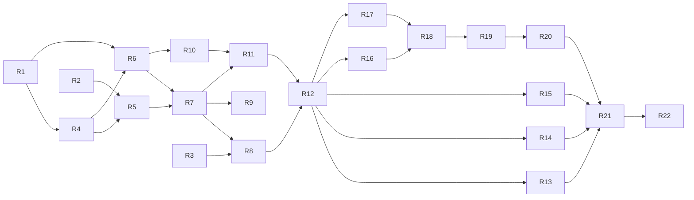

# Roadmap de implementação

A ordem em que a aplicação é construída, e por quê. O desenho está no [ARCHITECTURE.md](../ARCHITECTURE.md); as decisões difíceis de reverter, em [docs/adr](adr); o vocabulário, em [CONTEXT.md](../CONTEXT.md); o enunciado, em [CHALLENGE.md](CHALLENGE.md).

Cada ticket é uma issue do GitHub com o prefixo `[Rn]`, critérios de aceite e bloqueios nativos ("blocked by"). **O estado do trabalho vive nas issues**, não aqui: este documento guarda só o que muda pouco (ordem, razões e definição de pronto).

## Como o trabalho é fatiado

1. **`Money` primeiro, o resto em fatias verticais.** `Money` é um tipo puro que bloqueia tudo e não tem decisão aberta. O restante atravessa domínio, schema, caso de uso, borda e testes, porque as garantias que mais pontuam (concorrência, idempotência, recuperação) são propriedades do conjunto banco, código e mensageria, e só se provam com o fluxo de pé.
2. **Autenticação nasce com o primeiro endpoint.** Nenhuma rota de negócio existe sem proteção em nenhum commit da `main`: o registro de rotas exige declarar o papel, e um teste reprova qualquer rota sem autorização.
3. **Outbox cedo.** A escrita atômica do evento entra na primeira fatia que muda dinheiro (abrir carteira); o publisher vem logo depois, para provar a recuperação com eventos reais antes de entrarem as regras de apostas.
4. **`BET` completo antes dos outros tipos.** É o único débito simples, então é onde saldo negativo por concorrência e movimentação duplicada podem acontecer. Provadas nele (idempotência, lock por carteira, as duas apostas de 80 em 100, 50 envios paralelos, três processos), as demais fatias herdam a estrutura.
5. **SQS logo depois do `BET`.** Todo tipo de operação seguinte já nasce com os dois canais e com testes cruzados. Uma Reversal que chega antes da Reference só acontece de verdade por mensageria.
6. **Leituras com os dados que leem; reconciliação cedo.** O isolamento entre provedores nasce junto com as transações que ele protege. A reconciliação vem logo após o SQS e passa a ser a verificação final ("saldo armazenado igual à soma do ledger") de cada fatia financeira seguinte.
7. **Reversões em duas etapas.** Primeiro as síncronas (a Reference já existe: a matemática do dinheiro, o índice único, as combinações), depois o fluxo de Pending Reference (worker, backoff, TTL, reinício).
8. **Schema híbrido.** `wager_transactions` nasce na primeira fatia com toda a identidade, porque o `CHECK` que separa a abertura interna da operação externa exige as colunas externas. O resto (retomada, índice de reversão, inbox) cresce com a fatia que o usa, junto com o teste que tenta violá-lo.
9. **Observabilidade e contrato fazem parte de cada fatia.** Métricas, campos de log e as rotas no `api/openapi.yaml` (escrito antes do handler) entram com o ticket que cria o comportamento.
10. **Único extra planejado:** o teste de carga, como último ticket opcional (R22), porque é a forma de demonstrar com números o paralelismo entre carteiras e o custo dos triggers de coerência. Tracing fica de fora porque repete o que os logs com `correlationId`, `transactionId` e `messageId` já entregam; partidas dobradas, porque mudam o modelo do ledger, o ponto mais arriscado da integridade financeira, e são difíceis de reverter.

## Definição de pronto

Vale para todo ticket; as issues apontam para cá em vez de repetir.

1. **Testes unitários** das regras novas. A cobertura do domínio (90% por pacote) é cobrada pelo CI.
2. **Banco:** toda migration tem `up` e `down` testados, e toda constraint ou trigger novo tem um teste que tenta burlá-lo por SQL direto e precisa ser recusado.
3. **Concorrência, idempotência e recuperação** são cobertas por teste de integração ou multi-instância (com três processos quando a garantia for entre instâncias), nunca só por teste unitário.
4. **Endpoints:** a rota está no `api/openapi.yaml`, declara o papel exigido, e o teste de contrato valida requisição e resposta reais.
5. **Observabilidade:** as métricas e os campos de log que a fatia introduz, sem logar tokens nem payloads financeiros completos.
6. **Documentação:** `ARCHITECTURE.md` se uma decisão mudou, `README.md` se algo visível ao usuário mudou, `CONTEXT.md` se nasceu um termo.
7. **Cada garantia tem um teste que já foi visto falhando sem ela** (remover a proteção e confirmar que o teste reprova). Basta dizer isso na descrição do PR.
8. **CI verde** (os dez checks), título do PR em Conventional Commits, e `Closes #N` só quando a issue foi inteiramente entregue.
9. **Rollback documentado:** toda migration tem, no cabeçalho do `.down.sql`, o que desfaz, o que se perde (dados e proteções), as pré-condições e o comando; um teste reprova se faltar (ticket R2).

## Tickets

> **Situação:** R1 a R21 foram entregues (cada um em um PR com os checks verdes e as mutações descritas). R22, o teste de carga, é opcional e não foi feito. A evidência de cada critério e o resultado dos oito cenários estão em [DELIVERY.md](DELIVERY.md).

| Ticket | Entrega | Bloqueado por |
| --- | --- | --- |
| R1 `Money` | Value object: parsing estrito, aritmética com overflow, moedas, serialização | nada |
| R2 Migration rollback convention | Cabeçalho de rollback nos `.down.sql` e teste de guarda, aplicado à migration 000001 | nada |
| R3 Authentication core | Verificador OIDC, papéis, registro de rotas que exige o papel e teste de guarda; testes contra o Keycloak real | nada |
| R4 Wallet and ledger entry | Agregado `Wallet` e `LedgerEntry`: criação, reidratação, débito e crédito, versão | R1 |
| R5 Schema | `wallets`, `wager_transactions` (identidade), ledger com triggers de coerência e `outbox`, cada constraint com teste de violação por SQL | R2, R4 |
| R6 Opening transaction and events | `WagerTransaction` (caminho `OPENING`) e eventos de domínio (envelope, `WagerTransactionProcessed`, `WalletBalanceChanged`) | R1, R4 |
| R7 Open wallet use case | Caso de uso `openwallet`, repositórios pgx, `UnitOfWork` e escrita atômica na outbox | R5, R6 |
| R8 Wallet endpoints | `POST /wallets` e `GET /wallets/:id` autenticados, `openapi.yaml` base, `/openapi.yaml`, Swagger UI no Compose e teste de contrato | R3, R7 |
| R9 Outbox publisher | `SKIP LOCKED`, lease, backoff, `eventId` estável, atraso da outbox; provas de recuperação | R7 |
| R10 Wager domain | `WagerTransaction` externa, máquina de estados, regra do `BET`, hash canônico, catálogo de `failureCode` | R6 |
| R11 Process BET | Claim de idempotência, lock por carteira, débito, ledger, outbox, replay e conflito, Rejection por saldo | R7, R10 |
| R12 Wagering endpoint | `POST /wagering/transactions`: autorização por provedor, `Idempotency-Key`, mapeamento de erros, contrato | R8, R11 |
| R13 Guarantee test suite | 2×80 em 100, 50 envios paralelos, carteiras distintas, três processos, persistência após reinício | R12 |
| R14 Transaction reads | `GET` de transação com isolamento entre provedores, inclusive replay | R12 |
| R15 Ledger listing | `GET /wallets/:id/ledger` com cursor opaco e ordenação estável | R12 |
| R16 Inbox and SQS consumer | Ack só após commit, DLQ, `SIGTERM`, testes cruzando HTTP e SQS | R12 |
| R17 Reconciliation | `POST /wallets/:id/reconciliation` com snapshot consistente, log e métrica | R12 |
| R18 WIN and LOSS | Política de zero, `LOSS` sem `WalletBalanceChanged` | R16, R17 |
| R19 Synchronous reversals | Resolução de Reference, `REFUND`, `ROLLBACK`, índice único, combinações | R18 |
| R20 Pending Reference | `PENDING_REFERENCE`, worker com lease, backoff e TTL, expiração, reinício | R19 |
| R21 Delivery review | Revisão final dos documentos, conferência contra a tabela de avaliação, os oito cenários obrigatórios, `.env.example` e exemplos | R13, R14, R15, R20 |
| R22 Load test *(opcional)* | Teste de carga reproduzível | R21 |

`R1`, `R2` e `R3` podem começar ao mesmo tempo. O caminho mais longo vai de `R1` a `R20`; `R9`, `R13`, `R14` e `R15` andam ao lado dele.

